# Manual Workflow Connections

Current source wiring as of 2026-10-07. All `manual-*` workflows start through
`workflow_dispatch`; only arrows labelled **dispatches** or **calls** represent
automatic workflow handoffs. Other solid arrows show existing state, artifact,
or human-operated dependencies. Dashed arrows show planned integration, not
implemented automation or authorization to run it.

```mermaid
flowchart TB
	subgraph DISCOVERY["Discovery and catalog"]
		MD["manual-discovery<br/>Selected modules or exact continuation"]
		STATE[("factory-state<br/>Queue, ownership, pins, intents and receipts")]
		MC["manual-catalog-export<br/>Durable catalog proposal"]
	end

	subgraph COMPUTE["Dispatch and worker execution"]
		DIS["manual-dispatch<br/>Exact request or module"]
		MW["manual-worker<br/>Existing standalone worker"]
		DV["manual-dispatch-validation<br/>Exact claim and reusable handoff"]
		WV["manual-worker-validation<br/>Already claimed exact attempt"]
		FW["factory-worker<br/>Reusable workflow_call implementation"]
		ART[("Worker artifacts<br/>Launch and module evidence")]
		REC["manual-recovery<br/>Exact attempt and verified Actions outcome"]
		OPS["manual-operations<br/>Authorized pause, resume, retry and refresh"]
	end

	subgraph DELIVERY["Evidence and provider delivery"]
		EE["manual-evidence-export<br/>Exact sealed acquisition or assessment"]
		PC["manual-provider-collect<br/>Exact provider version and commit"]
		PA[("Provider proposal and cache artifacts")]
		PE["manual-provider-export<br/>Exact collection run and accepted base"]
		BR[("Data-only review branches")]
		PR{{"Human-reviewed PR merge into main"}}
		DATA[("Accepted data on main<br/>Modules, providers and rebuilt indexes")]
		AE["manual-accept-evidence<br/>Exact attempt and evidence merge commit"]
	end

	subgraph BOARD["Issue and Project projection"]
		PF["manual-projection-flush<br/>Exact modules with due existing delivery"]
		PX["manual-projection-recovery<br/>Selected existing intents; optional replay"]
		BOARDOUT["Recurring module Issues and Factory Board<br/>Human notes preserved"]
	end

	subgraph FUTURE["Planned stages: entry-point names not yet defined"]
		PI["Provider receipt import<br/>Accepted snapshots and input generations"]
		WAKE["Assessment input reconciliation<br/>Facts plus definitions, policy and snapshots"]
		SEL["Current analysis selection<br/>Independent context receipts"]
		SE["Selection export and merge-receipt import"]
		PRE["Safe presentation export"]
		PUB["Complete dataset publication<br/>Verified deployment receipt"]
		DONE["Current deployed selections<br/>Eligible for Done projection"]
	end

	MD -->|"persists discovery; never dispatches workers"| STATE
	MD -->|"projects within selected module cycle"| BOARDOUT
	STATE -->|"catalog outbox read"| MC
	MC -->|"prepares branch only"| BR

	STATE -->|"eligible durable work"| DIS
	DIS -->|"dispatches exact claim"| MW
	STATE -->|"eligible exact target"| DV
	DV -->|"calls with newly claimed identities"| FW
	WV -->|"calls with supplied claimed identities"| FW
	MW -->|"binds and seals completion"| STATE
	FW -->|"binds and seals completion"| STATE
	MW -->|"uploads"| ART
	FW -->|"uploads"| ART
	MW -->|"prepares evidence branch after sealing"| BR
	FW -->|"prepares evidence branch after sealing"| BR
	STATE -->|"attempt inspection"| REC
	REC -->|"verified recovery; not blind rerun"| STATE
	OPS -->|"fenced audited controls; no direct worker launch"| STATE

	ART -->|"verified exact artifact IDs"| EE
	STATE -->|"persisted seal validation"| EE
	EE -->|"prepares branch and opens or reuses exact PR"| BR
	PC -->|"uploads pinned proposal and cache"| PA
	PA -->|"verified collection provenance"| PE
	PE -->|"prepares branch only"| BR
	BR -->|"review; catalog/provider PR opening remains human-operated"| PR
	PR -->|"protected-main merge"| DATA
	DATA -->|"exact evidence merge commit"| AE
	ART -->|"revalidated producer artifacts"| AE
	AE -->|"imports verified facts or analysis receipt"| STATE

	STATE -->|"due existing delivery only"| PF
	STATE -->|"selected durable intents and delivery"| PX
	PF -->|"bounded delivery and acknowledgement"| BOARDOUT
	PX -->|"bounded repair and acknowledgement"| BOARDOUT

	DATA -.->|"provider merge receipt: not wired"| PI
	PI -.->|"import and narrow invalidation"| STATE
	STATE -.->|"facts accepted or input generation changed"| WAKE
	DATA -.->|"accepted facts, definitions and provider snapshots"| WAKE
	WAKE -.->|"enqueue eligible assess requests; no source checkout"| STATE
	AE -.->|"accepted analysis: select only if inputs remain current"| SEL
	SEL -.->|"durable selection export outbox"| SE
	SE -.->|"separate reviewed data PR"| PR
	DATA -.->|"accepted selections and meaningful lifecycle changes"| PRE
	PRE -.->|"reviewed presentation proposal"| PR
	DATA -.->|"exact accepted dataset commit"| PUB
	PUB -.->|"verified generation and membership receipt"| STATE
	STATE -.->|"all required current contexts deployed"| DONE
	DONE -.->|"durable projection intent and bounded flush"| BOARDOUT

	classDef manual fill:#eaf3ff,stroke:#2471a3,color:#17202a
	classDef reusable fill:#e8f5e9,stroke:#388e3c,color:#17202a
	classDef planned fill:#fff,stroke:#777,stroke-dasharray:5 5,color:#444
	class MD,MC,DIS,MW,DV,WV,REC,OPS,EE,PC,PE,AE,PF,PX manual
	class FW reusable
	class PI,WAKE,SEL,SE,PRE,PUB,DONE planned
```

## Important Boundaries

- Successful compute and sealing produce evidence, not accepted data or Done.
	Evidence PR merge and verified receipt import are separate operations.
- Both workers still have an in-run review-branch job. Manual evidence export
	provides a separate recovery path for already sealed artifacts; it does not
	rerun compute. Full durable delivery/outbox integration remains planned.
- The reusable validation path is staged separately from existing dispatch.
	Its credential availability has failed live validation; subsequent fixes
	are not yet proven by a successful worker run. The solid call arrows describe
	implemented wiring, not verified end-to-end success.
- Provider collection and export exist, but provider receipt import and
	assessment wake-up remain unwired. Missing accepted inputs cannot be replaced
	with guessed versions or silently treated as a pass.
- Queued/Analyzing lifecycle adapters and opt-in intent APIs exist, but current
	workflow callers do not enable those transition writes. Projection flush
	delivers existing due records; it does not create missing lifecycle work.
- Planned selection, presentation and publication stages must preserve review
	and environment gates. TASK-042 auto-merge is excluded from this diagram's
	implementation scope.

## Workflow Sources

| Area | Existing entry points |
| --- | --- |
| Discovery/catalog | [manual-discovery](../../.github/workflows/manual-discovery.yml), [manual-catalog-export](../../.github/workflows/manual-catalog-export.yml) |
| Dispatch/compute | [manual-dispatch](../../.github/workflows/manual-dispatch.yml), [manual-worker](../../.github/workflows/manual-worker.yml), [manual-dispatch-validation](../../.github/workflows/manual-dispatch-validation.yml), [manual-worker-validation](../../.github/workflows/manual-worker-validation.yml) |
| Shared implementation | [factory-worker](../../.github/workflows/factory-worker.yml), reusable rather than manually dispatchable |
| Recovery/controls | [manual-recovery](../../.github/workflows/manual-recovery.yml), [manual-operations](../../.github/workflows/manual-operations.yml) |
| Evidence | [manual-evidence-export](../../.github/workflows/manual-evidence-export.yml), [manual-accept-evidence](../../.github/workflows/manual-accept-evidence.yml) |
| Providers | [manual-provider-collect](../../.github/workflows/manual-provider-collect.yml), [manual-provider-export](../../.github/workflows/manual-provider-export.yml) |
| Projection | [manual-projection-flush](../../.github/workflows/manual-projection-flush.yml), [manual-projection-recovery](../../.github/workflows/manual-projection-recovery.yml) |

See the [pipeline delivery plan](../../plan/feature-native-pipeline-delivery-1.md),
[factory operations](../factory-operations.md), and
[task register](../TODOS.md) for implementation and live-verification gates.
