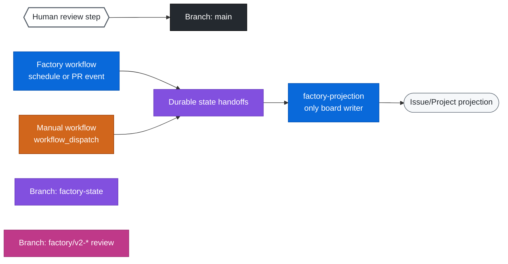
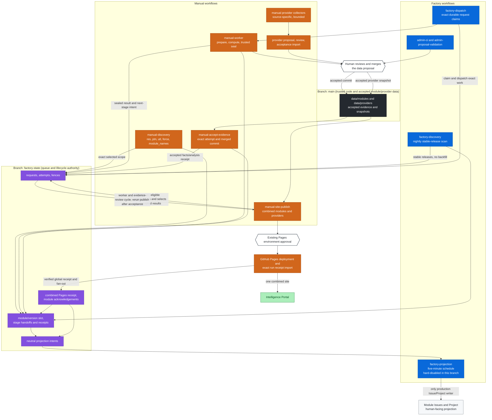
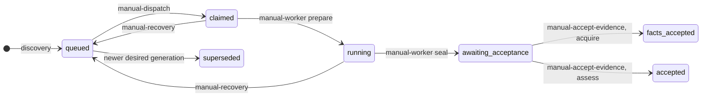

# Factory Operations: Workflows, Branches, And Board

Owner: Ledermayer.

This guide shows how the GitHub Actions workflows, the `main` and
`factory-state` branches, and the
[AVM Intelligence Factory](https://github.com/orgs/softwareone-public/projects/1)
board work together for one AVM module, from discovery to the intelligence
portal. It replaces the former board operations guide.

Authority is fixed:

- **`factory-state` is the durable queue and lifecycle authority.**
- **Data on `main`**, merged through reviewed pull requests, together with the
  verified receipts, governs canonical evidence and publication.
- **The board and the module Issues are projections** for people. They are
  never an input to the queue or an approval.

## Manual Discovery Pacing And Continuation

Manual discovery paces source reads and Git-backed state operations. It no longer
uses Issue or Project clients. Projection has a separate scheduled owner with
its own API budget and durable per-module checkpoints. Both paths retain server
retry guidance and leave headroom for state recovery; their local guards cannot
guarantee that undisclosed limits or concurrent installation traffic never
throttle a run.

Waits are cancellable and limited to one minute per admission. Longer pauses,
or the soft run cutoff, defer the exact stored cycle rather than broadening scope
or replaying earlier modules. The 30-minute job bound remains, with bounded
cleanup time. Server throttles are never bypassed for checkpoints. If cleanup
is blocked, the result says stopped/recoverable instead of claiming parking.

The job summary reports an exact `discovery-cycle-...` ID and retry time. Run
`manual-discovery` with only `continuation_id` populated: leave module names
empty and force off. Checkboxes do not redefine stored scope. Resume does not
collect a new catalog, repeat completed modules or recreate already-committed
forced source work. Competing owners, changed contracts and invalid scope fail
closed. No schedules, auto-dispatch or accepted-data changes are introduced.
Other workflows keep their existing budget policy until reviewed promotion.
This statement applies to discovery continuation; the independent
`factory-projection` schedule polls existing due delivery every five minutes.

## State Transport

Trusted state jobs check out `factory-state` into a separate depth-1
`work/state` directory with explicit repository/ref and
`persist-credentials: false`. State commands receive
`--state-branch factory-state --state-checkout-root work/state`. The verified
Git backend fetches the current ref and derives the exact tree itself; workflows
must not run `git ls-tree` to pass a listing or use dispatch/worker-specific
checkout aliases. The checkout provides immutable Git objects, not queue
authority. No state-branch code is executed.

The factory process mints an operation-time scoped state token from its App
credentials through a temporary credential provider. Workflows must not expose
tokens through `FACTORY_STATE_TOKEN`; credentials are not placed in arguments,
URLs, persistent Git configuration or logs. Only `factory-projection` mints the
reduced Issue/Project token. State-writer credentials remain separate from that
token and from credential-free compute. Non-state commands reject state flags.

Every write uses the shared transaction coordinator: fetch and validate a fresh
head, decide against one immutable snapshot, build a child commit and publish
with one non-force push. Confirmed contention discards the candidate and retries
the whole decision. Unknown publication is reconciled by durable operation
identity before retry. No REST state backend, pull/merge/rebase, force push or
transport fallback exists. Existing module-v2 encoding and explicit layout
migration utilities remain separate domain functionality; production CLI and
workflows do not invoke layout migration.

## Workflow Handoffs And Verification

State checkout is not a workflow handoff and does not authorize the next stage.
Discovery persists exact lifecycle intents; dispatch claims one durable request
before launching the worker; trusted preparation binds its run and fence; compute
remains credential-free; trusted sealing validates artifacts; acceptance imports
the exact merged receipt; selection and publication remain independent. Every
producer commits projection intents to state. The five-minute
`factory-projection` workflow reads due state before minting its reduced token
and applies those intents. Manual projection recovery prepares exact state-only
targets; manual flush validates exact existing due delivery. Neither performs
Issue or Project calls. Recovery never restarts discovery or broadens a target.

After a lost or uncertain Git publication, the coordinator fetches and resolves
the stable operation identity before another decision. A confirmed contention
starts a fresh decision; an unknown outcome is not treated as failure or success
without durable proof. Local fixture checks do not establish live App credentials,
repository policy, workflow activation or acceptance. See the state-transport
plan's TEST-013/014/015 and TASK-016/017/018 gates for workflow, no-REST,
performance and complete-diff review evidence.

## Legend

| Element | Shape and colour |
| --- | --- |
| Factory workflow | Blue box. Starts without a dispatch, from a schedule, a PR or the merge queue. |
| Manual workflow | Orange box. Starts only from `workflow_dispatch`. |
| Human step | White hexagon. A person opens and merges the PR. |
| Git branches | `main` dark grey, `factory-state` purple, `factory/v2-*` review branches pink. |
| Board status | Light rounded pill, with one colour per status (see [status mapping](#status-mapping)). |

## Module Journey

The diagram follows the reviewed v2 source contract. It is not evidence of a
live run: the projector job remains disabled, and the workflow steps below have
not been exercised against production state or Pages.

### Reviewed v2 Lifecycle

This describes the implementation in the review branch. It is local/source
evidence only; no live lifecycle or Pages run is claimed.

| Stage | Workflow | Durable result | External effect |
| --- | --- | --- | --- |
| Discover releases | [factory-discovery](../.github/workflows/factory-discovery.yml) or [manual-discovery](../.github/workflows/manual-discovery.yml) | Source pins, per-version requests, lifecycle and projection intents in `factory-state` | None; discovery never dispatches workers or writes Issues/Projects |
| Acquire or assess | [factory-dispatch](../.github/workflows/factory-dispatch.yml), [manual-dispatch](../.github/workflows/manual-dispatch.yml), [manual-worker](../.github/workflows/manual-worker.yml) | Fenced claim, trusted completion, and next-stage intent | Worker handoff only; compute has no state or projection credentials |
| Accept evidence | [manual-accept-evidence](../.github/workflows/manual-accept-evidence.yml) | Receipt-backed accepted facts or analysis and lifecycle handoff | Requires the reviewed data merge; acceptance does not select or publish |
| Collect provider intelligence | [manual-provider-collect](../.github/workflows/manual-provider-collect.yml), [manual-provider-resource-intelligence](../.github/workflows/manual-provider-resource-intelligence.yml), [manual-provider-export](../.github/workflows/manual-provider-export.yml), [manual-import-provider-snapshot](../.github/workflows/manual-import-provider-snapshot.yml) | Provider-owned proposals and exact accepted snapshot generations | Collection is separate from module assessment; only accepted snapshots wake dependent assessments |
| Prepare the combined site | [manual-site-publish](../.github/workflows/manual-site-publish.yml) | Imports exact merged selection receipts, queues eligible assessment requests, selects already accepted results, and writes one combined module/provider site manifest | Builds from one accepted `main` commit; an assessment queued here still needs its worker and evidence-acceptance stages before a later publication includes that result |
| Deploy and fan out | `manual-site-publish` | Exact Pages receipt plus per-module publication acknowledgements and projection intents | One combined Pages deployment; slot release requires exact complete required-context membership |
| Project Issues and Project | [factory-projection](../.github/workflows/factory-projection.yml) | Per-module effect receipts and delivery acknowledgements | Sole Issue/Project writer. Its job is hard-disabled in this review branch pending WP-41/HUMAN-002 |

Recovery paths branch off this flow without restarting discovery:

- **[manual-recovery](../.github/workflows/manual-recovery.yml)** requeues an
  attempt whose run is confirmed missing or ended without a seal. The target
  board status is Failed.
- **[manual-projection-recovery](../.github/workflows/manual-projection-recovery.yml)**
  prepares exact state-only recovery targets; the scheduled projector performs
  delivery. **[manual-projection-flush](../.github/workflows/manual-projection-flush.yml)**
  validates exact existing due targets. Neither workflow calls the Issue or
  Project APIs. See
  [native projection and recovery](#native-projection-and-recovery).

### Request Status On `factory-state`

Request records live in
[internal/queue/request.go](../internal/queue/request.go). The shared
lifecycle reducer `queue.ReduceModuleStatus` derives projection status from
durable request and context state; the projector never reads the board as input.

## Workflow Inventory

Every workflow:

- runs trusted code from `main`;
- sets `permissions: {}` at the top level;
- pins its actions to commit SHAs.

State commands accept only the `factory-state` branch. The workflow naming and
manual-first promotion rules are in the
[GitHub operations instructions](../.github/instructions/github-operations.instructions.md).

| Workflow | Type | Trigger | Writes | Board |
| --- | --- | --- | --- | --- |
| [admin-ci](../.github/workflows/admin-ci.yml) | Factory | PR, push to `main` | Nothing | None |
| [factory-discovery](../.github/workflows/factory-discovery.yml) | Factory | Nightly schedule | `factory-state` intents | None |
| [factory-projection](../.github/workflows/factory-projection.yml) | Factory | Five-minute schedule | Issue, Project item, `factory-state` delivery receipts | Current reduced lifecycle status; job hard-disabled pending WP-41/HUMAN-002 |
| [admin-proposal-validation](../.github/workflows/admin-proposal-validation.yml) | Factory | `pull_request_target` and `merge_group` on `main` | Nothing | None |
| [manual-discovery](../.github/workflows/manual-discovery.yml) | Manual | Module type checkboxes, `force`, `module_names` | `factory-state` intents | None |
| [factory-dispatch](../.github/workflows/factory-dispatch.yml) | Factory | Twice hourly | `factory-state`, then dispatches `manual-worker` | None |
| [manual-dispatch](../.github/workflows/manual-dispatch.yml) | Manual | One `request_id` or one `module_id` | `factory-state`, then dispatches `manual-worker` | None |
| [manual-worker](../.github/workflows/manual-worker.yml) | Manual | `attempt_id`, `request_id`, `fence`, `dispatcher_id` | `factory-state`, `factory/v2-evidence-*` | None |
| [manual-accept-evidence](../.github/workflows/manual-accept-evidence.yml) | Manual | `attempt_id`, `evidence_commit` | `factory-state` | None |
| [manual-catalog-export](../.github/workflows/manual-catalog-export.yml) | Manual | None | `factory/v2-catalog-*` | None |
| [manual-provider-collect](../.github/workflows/manual-provider-collect.yml) | Manual | Exact provider, version and revision | Artifacts only | None |
| [manual-provider-resource-intelligence](../.github/workflows/manual-provider-resource-intelligence.yml) | Manual | Exact provider resource/version targets | Artifacts only | None |
| [manual-provider-export](../.github/workflows/manual-provider-export.yml) | Manual | `accepted_base`, `collection_run_id` | `factory/v2-provider-*` | None |
| [manual-import-provider-snapshot](../.github/workflows/manual-import-provider-snapshot.yml) | Manual | Exact merged provider snapshot | `factory-state` accepted-input receipts | None |
| [manual-selection-export](../.github/workflows/manual-selection-export.yml) | Manual | Exact module, release and context selections | `factory/v2-selection-*` | None |
| [manual-site-publish](../.github/workflows/manual-site-publish.yml) | Manual | Exact current `main` commit | Pages plus `factory-state` deployment receipts | Pages only; no Issue/Project writes |
| [manual-operations](../.github/workflows/manual-operations.yml) | Manual | `operation`, `module_id`, `reason` | `factory-state` operator controls | None |
| [manual-recovery](../.github/workflows/manual-recovery.yml) | Manual | `attempt_id` | `factory-state` | None |
| [manual-projection-recovery](../.github/workflows/manual-projection-recovery.yml) | Manual | Module type checkboxes, `force`, `module_names` | `factory-state` intents | None |
| [manual-projection-flush](../.github/workflows/manual-projection-flush.yml) | Manual | Exact `module_names` | Reads exact due `factory-state` intents | None |

Provider collection is independent of module releases. Exact accepted provider
snapshot generations and policy inputs are prerequisites for dependent
assessments; missing or deferred contexts remain visible as partial coverage.

## Branches

| Branch | Role | Who writes it |
| --- | --- | --- |
| `main` | Trusted code, workflows, configuration and the accepted `data/**` dataset. Protected: changes arrive only through reviewed PRs with the `Test` check. | Humans, by merging reviewed PRs |
| `factory-state` | JSON files under `state/`. Holds discovery, requests, attempts, fences, outboxes, projection delivery, operator controls and receipts. Each write is a child commit of the expected head with a non-force ref update. | State-writer workflows, using the App Contents token |
| `factory/v2-evidence-*`, `factory/v2-catalog-*`, `factory/v2-provider-*` | Data-only proposals: `proposal.json` plus `data/**`, against an exact `expected_base`. | Worker and export workflows. A human opens the PR. |

Never edit `factory-state` JSON by hand or force-update any ref. See
[decisions](decisions.md) for the fencing and expected-head rules.

## Board Views

Project: [AVM Intelligence Factory](https://github.com/orgs/softwareone-public/projects/1)

| View | Purpose | Primary filter |
| --- | --- | --- |
| Factory board | Review all factory and module work by status. | All work types |
| Catalog | Scan the accepted module cohort. | Work type = Module analysis |
| Needs attention | Triage blocked, failed, and review-required work. | Status = Blocked, Failed, or Needs review |
| Delivery roadmap | Track product implementation. | Work type = Implementation |

## Module Issue Contract

- **One Issue per module.** Each active module has one recurring Issue,
  identified by a stable hidden module marker.
- **Updates reuse that Issue.** A new source release or a new analysis attempt
  updates it; it never creates a new Issue.
- **Retirement.** A retired module's Issue is closed only after the catalog
  retirement rule is satisfied.

The Issue and the Project item are projections of durable request state and
accepted results. Moving a card does not authorize any work. Human notes stay
outside the summary block that the factory owns.

### Discovery entry points

Discovery and board delivery log per-module progress at the default INFO level.
Each operation identifies its component/phase and, where applicable, module,
position/total and request or Issue identity. Source resolution reports version,
commit, change/force decisions and acquisition no-ops. State commits and board
delivery acknowledgements are reported only after success; prepared events are
not yet durable. Long operations emit "operation waiting" every 30 seconds with
elapsed time, without changing leases or retry behavior. Pagination, cache reuse,
field no-ops and API budget/retry events expose the active work. One terminal
ERROR remains CLI-owned; incomplete stages emit safe WARN events without API
bodies or credentials. The reporter uses the configured stream and severity.

- **Nightly discovery.** The
  [factory discovery workflow](../.github/workflows/factory-discovery.yml) runs
  full-catalog observation and checks every active module ID for new stable AVM
  releases. The first check establishes that module's current release as its
  baseline without importing older versions; later checks retain every stable
  release after that baseline, including multiple releases between nightly
  scans. Discovery only writes state and never starts workers. Versions wait in
  the module slot through assessment and verified publication.
- **Manual discovery.** Its
  [manual counterpart](../.github/workflows/manual-discovery.yml) takes:
  - RES, PTN and UTL checkboxes;
  - `force`;
  - `module_names`, a comma-separated list of canonical IDs. A non-empty list
    selects exactly those modules and ignores all type checkboxes, checked or
    unchecked. An empty or whitespace-only list selects every active module of
    the checked types. No list and no checked types fails closed.
- **Manual module cycles.** The single `--discovery-module-cycle` step records
  shared observation once, then orders selected IDs RES, UTL, PTN and by ID
  within each type. Each module resolves its source and commits its source pin,
  request, lifecycle handoff, and projection intent to `factory-state`. Discovery
  does not call the Issue or Project APIs and does not wait for board delivery;
  the scheduled `factory-projection` workflow consumes due intents separately.
- **Cycle failure and recovery.** A source-resolution or state-commit failure
  stops the cycle. Earlier module commits remain durable and later modules stay
  due for a subsequent run. Projection failures are handled independently by the
  scheduled projector and do not make discovery replay completed work. An
  ordinary manual retry reuses unchanged queued work and does not bypass
  ownership or review. Force requests reprocessing, not a recovery shortcut.
- **Read reuse and exports.** The run reuses reduced API budgets and catalog
  metadata. Immutable state blobs are cached by SHA; paced discovery reuses a
  decoded snapshot only after checking the live ref and reloads on head change.
  Writes invalidate that cache and retain expected-head validation. Release
  checks reuse verified tags only within one resolution, never across checks.
  Read-only skip cursors checkpoint after sixteen modules or one minute, before
  mutations, at deferral and at completion. A crash can repeat read-only checks;
  intervening head movement fails closed. Source-pin
  commits retain immutable catalog outboxes; a generation-bound current-outbox
  reference selects the exact latest export without deleting earlier candidates.
- **Re-runs.** An ordinary run does not refresh acquisition work that hasn't
  changed. `force`, labelled "Queue source reprocessing even when unchanged",
  queues a new acquisition generation even for unchanged selected sources and
  refreshes their state projection intent. It is not a metadata-only refresh or
  board repair. The card shows Backlog until a dispatcher claims the work and
  the scheduled projector delivers the state intent.
- **No worker dispatch.** Neither entry point dispatches workers; the durable
  queue stays authoritative.
- **Global bookkeeping.** Catalog and retirement bookkeeping always covers the
  whole catalog. A manual selection narrows only source resolution, not
  membership of the accepted catalog.

### Run evidence comments

V2 reuses the same module Issue; evidence comments identify module, phase and
workflow run/attempt, not discovery generation alone.

- **One comment per phase/run-attempt.** New runs, attempts and phases create
  distinct App-owned comments, including forced discovery of an unchanged
  source. Retrying within the same attempt updates its exact hidden marker.
- **Contents.** The comment records:
  - phase, run/attempt identity and workflow-run link;
  - module/source identity, lifecycle status and phase outcome;
  - the durable state checkpoint link and allowlisted diagnostic category.
- **Where status lives.** The current status stays in the Issue summary and the
  Project fields. Recovery preserves each earlier run's own outcome/context.
- **Acknowledgement.** Comment work is durable before mutation; board/Issue and
  required comments must succeed before acknowledgement. Retry verifies exact
  Bot/App-owned markers and body, repairing lost checkpoints without duplicate
  POSTs. Failed or quota-blocked comments stay pending for an eligible retry.
- **Current entry points.** Discovery and projection recovery enqueue evidence.
  The shared writer supports additional phase identities when their lifecycle
  projections are wired (F-019). Human/other-App comments are never edited and
  ambiguous markers fail closed. Comment calls consume existing API budgets.

### Budget diagnostics

Discovery pacing has four separate layers:

| Layer | Authority and purpose |
| --- | --- |
| GitHub quotas | Live REST, GraphQL and search quota responses, plus server-directed retry deadlines. |
| Local pacer | Conservative rolling costs and reserves shared by state and projection clients within the paced operation. |
| Durable delivery retry | A pending module's persisted `retry_at`; restarting a workflow does not clear its backoff. |
| Workflow orchestration | Bounded execution segments, durable checkpoints and automatic waiting/resume in the same approved job. |

The local pacer policy is not a declaration of GitHub's exact accounting:

| Local policy | Current value |
| --- | --- |
| REST point allowance | 720 points per rolling minute |
| GraphQL point allowance | 1,600 points per rolling minute |
| Request cost | One point for reads; five for mutations |
| Shared mutation spacing | At least one second across state and projection |
| Mutation allowance | 64 per rolling minute and 400 per rolling hour |
| Checkpoint reserve | 12 mutations reserved in each mutation window; ordinary work uses at most 52/minute and 388/hour |
| Final parking reserve | Last three mutations, 23 REST/GraphQL points and 11 primary calls are unavailable to ordinary checkpoints; reserved for cursor reads and Git candidate/push parking writes |
| Primary quota reserve | Ordinary requests retain 20% of the reported quota limit |
| In-segment wait bound | At most one minute, and never beyond the active context deadline |
| Local retry probe interval | At most five minutes for local rolling/reserve limits; probe does not grant admission |

Server pauses apply to checkpoint requests too; cleanup reserves do not bypass
GitHub throttling. Primary quotas refresh from live responses after resets,
rather than assuming a reset refilled them. The private same-job pacing session
preserves rolling costs and pauses between execution segments, not credentials
or lifecycle authority. Other processes are not represented by that local
ledger; conservative headroom and server feedback remain necessary.

Only final continuation parking uses the final parking reserve; routine cursor
and projection checkpoints cannot consume it. Parking may wait for local
capacity for at most five minutes, bounded by parent cancellation/deadline,
without bypassing server pauses or exhausted primary quotas. Its exact-head
transaction still fails closed on concurrent state changes. The reserve covers
the usual cached cursor transaction, not unlimited retries, unrelated callers
or arbitrary cache misses.

Skips still perform release and live-head reads, plus bounded batch checkpoint
writes. They avoid acquisition and acknowledged Issue/Project delivery. A run
that has skipped everything so far may nevertheless wait at its first pending
module: its existing delivery retry deadline was persisted by an earlier run.
That is inherited backoff, not evidence the current run exhausted its quota.
The cycle does not pass that module until its delivery completes. Current code
honors legacy stored deadlines when their cause/request cost is unknown.
New classified local retries persist their pacing reason and rejected request
cost. After at most five minutes, paced manual delivery refreshes live primary
quotas and evaluates that request against retained rolling costs before claiming
work or posting evidence. A still-blocked probe schedules another five-minute
recheck without charging the rejected request or replaying pending source work.
Server-directed pauses and actual exhausted primary quota reset deadlines are
never capped. Old unclassified delays remain protected; no retroactive state
rewrite or quota threshold increase is performed.

Request boundaries emit WARN `reason=local_projection_budget_exhausted` for our
reserve guard, or `reason=github_rate_limited` for a GitHub response. Safe fields
include module/phase, resource, remaining/reserve counters and server retry time
when present. Typed causes survive cycle wrapping; the single terminal ERROR
includes overall module position/total, completed count and retry checkpoint
instead of generic input advice. API bodies/credentials remain private. Budget
thresholds, retry delays, leases and workflow targets are unchanged.

### Automatic same-job continuation

Manual discovery now runs bounded execution segments inside one six-hour job.
After a durable deferral it waits for the stored retry deadline, with periodic
waiting messages, then resumes the exact continuation automatically. It clears
fresh selectors/force, preserves frozen scope and run identity, refreshes state
tokens and retains local rolling pacing charges in a private run-local file.
Primary quotas remain live reads. No new workflow or worker is dispatched and
the existing environment approval remains in place. Cancel the workflow run
to stop automatic continuation; pending work stays durable and leases expire
normally. The loop stops visibly at 350 minutes or an unsafe/error result;
operations longer than the hosted job bound retain an exact continuation rather
than claiming completion. New runs do not automatically resume old runs.
The loop starts a segment only when its 27-minute budget fits the remaining
operation time; it can therefore stop earlier than 350 minutes.

Deferred, stopped and persisted logs share `completed`, `remaining`,
`release_checked`, `skipped`, `source_changed` and `delivery_completed` counts.
Source changes mean recorded source-pin/history changes, not board updates.
`wait_reason` identifies a classified retry in deferred events and workflow
waiting messages; historical records may show an unspecified reason.
Paced warnings use `local_pacing_limit` and `pacing_reason` (primary reserve,
local minute/hour limits or server pause); unavailable legacy counters are
omitted, not shown as zeros.

Count meanings are stage-specific, not mutually exclusive:

| Field | Meaning |
| --- | --- |
| `release_checked` | Distinct modules that reached a completed source-resolution decision, including blocked/no-release results and a module that later deferred. |
| `skipped` | Modules requiring no source/lifecycle change and whose current delivery was already acknowledged with no pending evidence. |
| `source_changed` | Modules with recorded source-pin/history changes, including initial pins; not a count of board writes. |
| `delivery_completed` | Modules whose delivery callback returned successfully; not necessarily a count of remote mutations. |
| `completed` | Modules whose cycle finished, including skips and delivery completions. |
| `remaining` | Selected scope minus completed cycles, including the waiting module. |

For example, 30 checked, 29 completed, 29 skipped and zero deliveries means
the first 29 modules were no-ops and the thirtieth reached source resolution
but could not finish delivery. `waiting_module_id` and `retry_at` identify that
boundary. Counts do not establish accepted evidence, publication or fleet
completion. A newly started run can inherit module backoff without resuming an
old cycle; automatic continuation applies only to its own exact durable ID.

`continuation_durable=true` means a validated continuation exists.
`deferral_saved=true` additionally proves the deferred cursor transaction was
saved (or read back as already deferred). Automatic resume requires both plus
`deferred=true`; failed parking reports `deferral_saved=false` and stops rather
than claiming a recoverable parked cursor. Earlier completed work and pending
source phases remain available for exact-ID recovery after ownership checks.
Inside a paced resume, every routine pacing wall — the initial exact-cursor
read, the owner-claim lease write, and a post-module checkpoint — is converted
to a saved durable wait (or, when both the write and its parking retry hit the
local wall, the untouched stored deferral is re-proved and reported) instead of
a fatal exit, so the loop always waits rather than failing; only an outcome the
durable record cannot prove remains a failure.

An evidence transaction failure must not erase the last successfully committed
head returned to the discovery cycle. Parking retains that expected head and
does not infer successful commits from prepared trees. A failed park is logged
as a deferral-checkpoint failure with `parking_failed=true` and a safe
`parking_failure_reason`; the original pacing attributes remain available
separately. Neither condition permits bypassing concurrent-head checks.

## Status Mapping

| Board status | Meaning | Current state projection maps this status |
| --- | --- | --- |
| Backlog | Known work waiting for a dispatcher to pick it up, or for a manual retry. A durable request may already exist. The durable queue, not the card, decides eligibility. | Yes |
| Queued | The durable request is ready for a worker. | Yes |
| Analyzing | A worker run owns the request. | Yes |
| Validating | Artifacts are being checked before acceptance. | Yes |
| Publishing | An accepted result is waiting for Pages deployment. | Yes |
| Done | Every current required context has its exact accepted analysis and selection membership in the active verified deployment generation. | Yes |
| Needs review | A human decision is required. | Yes |
| Failed | An infrastructure or processing failure that can be retried. | Yes |
| Blocked | A required source, release, permission or policy input is unavailable. | Yes |
| Retired | The accepted catalog no longer lists the module as active. | Yes |

This table describes the projection contract in reviewed code. The scheduled
projector job remains hard-disabled in this branch, so no live delivery is
claimed.

## Native Projection And Recovery

The `factory-projection` workflow polls every five minutes and consumes durable
native lifecycle intents. The schedule is not a delivery SLA. It verifies
the factory summary, the owned labels and the configured Project fields before
it writes an acknowledgement. One module's failure does not invalidate another
module's evidence. API budgets, leases, generation fences and per-module
checkpoints all stay in force.

Managed fields include:

- source version and SHA;
- last analyzed;
- outcome;
- run URL;
- verified published commit.

The factory summary names the native factory, not an external analyzer.
Retirement stops writing the old analyzer field but does not delete it or change
remote Project settings.

### Board-only recovery

- **Tools.** Use the exact-module
  [projection recovery workflow](../.github/workflows/manual-projection-recovery.yml)
  and the [recovery skill](../.github/skills/v2-projection-recovery/SKILL.md).
- **Scope.** Recovery writes only selected state intents. It never calls the
  Issue or Project APIs, discovers, reanalyzes, accepts or deploys data. The
  scheduled projector consumes the durable intents on a later tick.
- **Evidence.** Use immutable accepted records and receipts, not stale cards.
  The historical mismatch between publication and the board remains documented
  in [F-001](FINDINGS.md#f-001-deployment-receipt-matches-board-reconciliation-does-not).

### Recovery inputs

Recovery takes the same five module inputs as manual discovery.

- **A normal run** keeps existing delivery fingerprints and skips modules whose
  convergence is already acknowledged.
- **`force`** requests a fresh drift check of acknowledged delivery. It does not:
  - replace lifecycle evidence;
  - preempt an active lease;
  - clear review state;
  - bypass retry backoff.
- **Incident repair** always takes the approved exact module list; never infer a
  wider cohort.

The manual workflows do not bypass the scheduled projector or change stored
retry deadlines. Schedule activation and live delivery remain rollout-gated.
