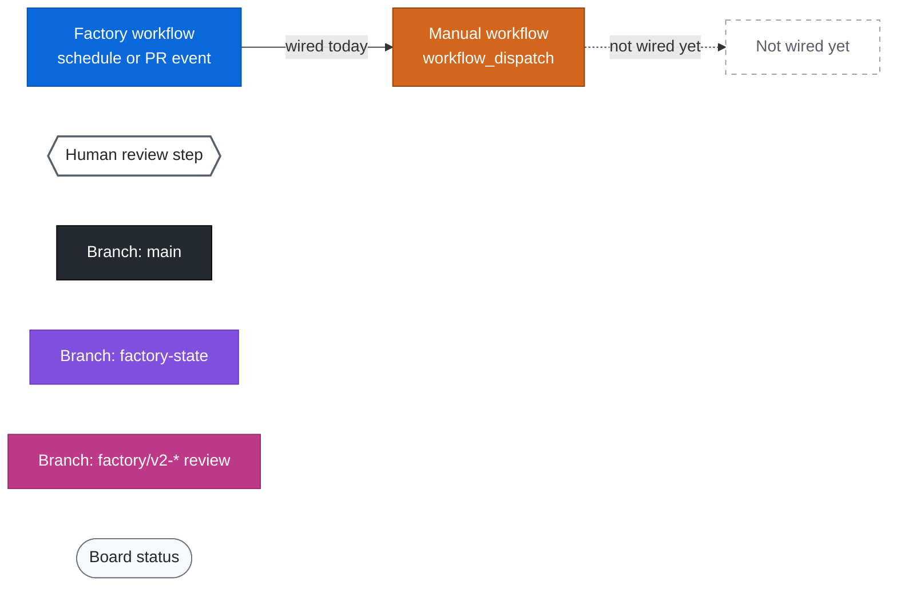
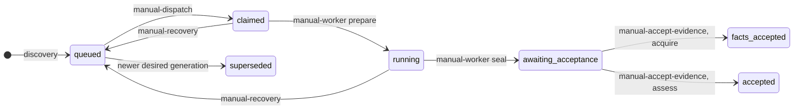

# Factory Operations: Workflows, Branches, And Board

Owner: Ledermayer.

This guide shows how the GitHub Actions workflows, the `main` and
`factory-state` branches, and the
[AVM Intelligence Factory](https://github.com/orgs/softwareone-public/projects/1)
board work together for one AVM module, from discovery to the intelligence
portal. It replaces the former board operations guide.

Authority is fixed:

- **`factory-state` is the durable queue and lifecycle authority.**
- **Data on `main`**, merged through reviewed pull requests, together with the
  verified receipts, governs canonical evidence and publication.
- **The board and the module Issues are projections** for people. They are
  never an input to the queue or an approval.

## Manual Discovery Pacing And Continuation

Manual discovery shares one request gate between state and Issue/Project clients.
Reads cost one local secondary point; mutations cost five and are spaced at least
one second apart. Rolling limits retain headroom: 720 REST points/minute, 1600
GraphQL points/minute and 64 content-generating requests/minute or 400/hour.
Twelve mutation slots are reserved for durable cleanup; ordinary work stops
before consuming them. Git object writes are counted conservatively as mutations.
Primary headroom uses 20% of the actual server-reported limit and an explicit
quota refresh after reset. These local guards cannot guarantee that undisclosed
limits or concurrent installation traffic never throttle a run.

Waits are cancellable and limited to one minute per admission. Longer pauses,
or the soft run cutoff, defer the exact stored cycle rather than broadening scope
or replaying earlier modules. The 30-minute job bound remains, with bounded
cleanup time. Server throttles are never bypassed for checkpoints. If cleanup
is blocked, the result says stopped/recoverable instead of claiming parking.

The job summary reports an exact `discovery-cycle-...` ID and retry time. Run
`manual-discovery` with only `continuation_id` populated: leave module names
empty and force off. Checkboxes do not redefine stored scope. Resume does not
collect a new catalog, repeat completed modules or recreate already-committed
forced source work. Competing owners, changed contracts and invalid scope fail
closed. No schedules, auto-dispatch or accepted-data changes are introduced.
Other workflows keep their existing budget policy until reviewed promotion.

## Legend

| Element | Shape and colour |
| --- | --- |
| Factory workflow | Blue box. Starts without a dispatch, from a schedule, a PR or the merge queue. |
| Manual workflow | Orange box. Starts only from `workflow_dispatch`. |
| Human step | White hexagon. A person opens and merges the PR. |
| Git branches | `main` dark grey, `factory-state` purple, `factory/v2-*` review branches pink. |
| Board status | Light rounded pill, with one colour per status (see [status mapping](#status-mapping)). |
| Not wired yet | Dashed white box or dashed arrow. A contract or code exists, but no workflow does it yet. |

## Module Journey

The numbers on the arrows follow one module in order. A solid arrow is a step a
workflow performs today. A dashed arrow is a target step that is not wired yet
(see [F-019](FINDINGS.md#f-019-board-progress-and-pages-publication-are-not-wired)).

```mermaid
flowchart TB
  subgraph MAIN["Branch: main (trusted code for every run, protected, reviewed PRs only)"]
    MAINDATA["data/** accepted dataset<br/>catalog, module evidence, indexes"]:::branchmain
  end

  subgraph AUTO["Factory workflows"]
    FD["factory-discovery<br/>nightly 03:17 UTC"]:::factory
    FPV["factory-proposal-validation<br/>PR and merge queue gate"]:::factory
    FCI["factory-ci<br/>Test check"]:::factory
  end

  subgraph MANUAL["Manual workflows"]
    MD["manual-discovery<br/>res, ptn, utl, force, module_names"]:::manual
    MCE["manual-catalog-export"]:::manual
    MDP["manual-dispatch<br/>exact request_id"]:::manual
    MW["manual-worker<br/>prepare, compute, seal, evidence branch"]:::manual
    MAE["manual-accept-evidence<br/>attempt_id, evidence_commit"]:::manual
    MREC["manual-recovery<br/>attempt_id"]:::manual
    MPR["manual-projection-recovery<br/>res, ptn, utl, force, module_names"]:::manual
  end

  subgraph STATE["Branch: factory-state (durable queue and lifecycle authority)"]
    SDISC["state/discovery<br/>catalog, source pins"]:::branchstate
    SEXP["state/exports<br/>catalog outbox"]:::branchstate
    SREQ["state/requests, state/attempts<br/>queued, claimed, running,<br/>awaiting_acceptance, facts_accepted"]:::branchstate
    SPROJ["state/projection<br/>intents, delivery, bindings"]:::branchstate
    SPUB["state/publications<br/>evidence receipts"]:::branchstate
  end

  subgraph REVIEW["Review branches pushed by workflows"]
    RCAT["factory/v2-catalog-RUN"]:::branchreview
    REV["factory/v2-evidence-RUN-ATTEMPT"]:::branchreview
  end

  PR{{"Human opens and merges<br/>data-only PR into main"}}:::human

  subgraph BOARD["Factory Board: Issue summary, labels, Project Status"]
    direction LR
    BBACK(["Backlog"]):::backlog
    BQ(["Queued"]):::queued
    BAN(["Analyzing"]):::analyzing
    BVAL(["Validating"]):::validating
    BPUB(["Publishing"]):::publishing
    BDONE(["Done"]):::done
    BREV(["Needs review"]):::needsreview
    BFAIL(["Failed"]):::failed
    BBLK(["Blocked"]):::blocked
    BBACK ~~~ BQ ~~~ BAN ~~~ BVAL ~~~ BPUB ~~~ BDONE ~~~ BREV ~~~ BFAIL ~~~ BBLK
  end

  subgraph TARGET["Not wired yet"]
    PASS["Assessment wake-up,<br/>assess dispatch and worker"]:::planned
    PSEL["Selection export<br/>reviewed PR"]:::planned
    PPAGES["Pages deployment,<br/>deployment receipt"]:::planned
    PORTAL["Intelligence portal<br/>GitHub Pages"]:::planned
  end

  FD -->|"1. discover and persist"| SDISC
  MD -->|"1. targeted or forced discovery"| SDISC
  SDISC -->|"1. queued acquire_source"| SREQ
  SDISC -->|"1. catalog outbox"| SEXP
  FD -->|"2. projection intent"| SPROJ
  MD -->|"2. projection intent"| SPROJ
  SPROJ -->|"2. project"| BBACK
  SPROJ -->|"2. source unavailable"| BBLK
  SPROJ -->|"2. moved or ambiguous tag"| BREV
  MPR -->|"repair existing intents only"| SPROJ

  SEXP -->|"3. read outbox"| MCE
  MCE -->|"3. push"| RCAT
  RCAT --> PR

  MDP -->|"4. claim, new fence"| SREQ
  MDP -->|"5. gh workflow run"| MW
  MW -->|"6. bind running,<br/>seal awaiting_acceptance"| SREQ
  MW -->|"7. push evidence"| REV
  REV --> PR
  FPV -->|"8. validate proposal"| PR
  FCI -->|"8. Test"| PR
  PR -->|"9. merge"| MAINDATA
  MAINDATA -->|"10. verify merge commit"| MAE
  MAE -->|"10. receipt"| SPUB
  MAE -->|"10. facts_accepted"| SREQ
  MREC -->|"requeue transient failure"| SREQ

  MDP -.->|"not projected"| BQ
  MW -.->|"not projected"| BAN
  MW -.->|"not projected"| BVAL
  MREC -.->|"not projected"| BFAIL
  SPUB -.->|"11. wake assessment"| PASS
  PASS -.->|"12. export selection"| PSEL
  PSEL -.->|"13. reviewed PR"| PR
  PSEL -.->|"not projected"| BPUB
  MAINDATA -.->|"14. deploy exact commit"| PPAGES
  PPAGES -.->|"15. publish"| PORTAL
  PPAGES -.->|"verified membership"| BDONE

  classDef factory fill:#0969da,stroke:#0550ae,color:#ffffff
  classDef manual fill:#d1661c,stroke:#953800,color:#ffffff
  classDef human fill:#ffffff,stroke:#57606a,stroke-width:2px,color:#24292f
  classDef branchmain fill:#24292f,stroke:#000000,color:#ffffff
  classDef branchstate fill:#8250df,stroke:#6639ba,color:#ffffff
  classDef branchreview fill:#bf3989,stroke:#99286e,color:#ffffff
  classDef planned fill:#ffffff,stroke:#8c959f,stroke-dasharray:5 5,color:#57606a
  classDef backlog fill:#f6f8fa,stroke:#6e7781,color:#24292f
  classDef queued fill:#ddf4ff,stroke:#54aeff,color:#0a3069
  classDef analyzing fill:#b6e3ff,stroke:#0969da,color:#0a3069
  classDef validating fill:#fbefff,stroke:#a475f9,color:#3e1f79
  classDef publishing fill:#d1f5f0,stroke:#1b7c83,color:#0c4a4f
  classDef done fill:#aceebb,stroke:#1a7f37,color:#044f1e
  classDef needsreview fill:#fff1c2,stroke:#bf8700,color:#4d2d00
  classDef failed fill:#ffcecb,stroke:#cf222e,color:#82071e
  classDef blocked fill:#ffebe9,stroke:#82071e,stroke-width:2px,color:#82071e

  style MAIN fill:#f6f8fa,stroke:#24292f
  style AUTO fill:#ddf4ff,stroke:#0969da
  style MANUAL fill:#fff1e5,stroke:#bc4c00
  style STATE fill:#f5f0ff,stroke:#8250df
  style REVIEW fill:#ffeff7,stroke:#bf3989
  style BOARD fill:#ffffff,stroke:#6e7781
  style TARGET fill:#ffffff,stroke:#8c959f,stroke-dasharray:5 5
```

### Step By Step

| Step | Workflow | Type | Reads | Writes | Request status | Board today | Board target |
| --- | --- | --- | --- | --- | --- | --- | --- |
| 1 | [factory-discovery](../.github/workflows/factory-discovery.yml) or [manual-discovery](../.github/workflows/manual-discovery.yml) | Factory / manual | `main`, `factory-state`, AVM catalogs and releases | `factory-state`: catalog, source pin, request, outbox | `queued` | — | Backlog |
| 2 | Same run, projection step | Factory / manual | `factory-state` intents | Issue, Project item, `state/projection` | `queued` | Backlog, Blocked or Needs review | Same |
| 3 | [manual-catalog-export](../.github/workflows/manual-catalog-export.yml) | Manual | `main`, `factory-state` outbox | `factory/v2-catalog-<run>` | — | Unchanged | Unchanged |
| 4 | [manual-dispatch](../.github/workflows/manual-dispatch.yml) | Manual | `main`, `factory-state` | `factory-state`: claim, attempt, fence | `claimed` | Backlog | Queued |
| 5 | Dispatch hands off with `gh workflow run manual-worker.yml` | Manual | — | — | `claimed` | Backlog | Queued |
| 6 | [manual-worker](../.github/workflows/manual-worker.yml) prepare, compute, seal | Manual | `main`, `factory-state`, Azure source at the exact SHA | `factory-state`: bind, seal | `running`, then `awaiting_acceptance` | Backlog | Analyzing, then Validating |
| 7 | manual-worker evidence job | Manual | Sealed artifact | `factory/v2-evidence-<run>-<attempt>` | `awaiting_acceptance` | Backlog | Validating |
| 8 | [factory-proposal-validation](../.github/workflows/factory-proposal-validation.yml) and [factory-ci](../.github/workflows/factory-ci.yml) | Factory | Trusted base code; candidate as data only | Nothing | `awaiting_acceptance` | Backlog | Validating |
| 9 | Human review and merge | Human | Review branch | `main` `data/**` | `awaiting_acceptance` | Backlog | Validating |
| 10 | [manual-accept-evidence](../.github/workflows/manual-accept-evidence.yml) | Manual | `main` merge commit, worker artifacts | `factory-state`: receipt, request status | `facts_accepted` | Backlog | Backlog, until assessment is due |
| 11–13 | Assessment, then selection export PR | Not wired | Accepted facts and exact provider and policy inputs | `factory-state`, then `main` | `accepted` | — | Analyzing, Validating, then Publishing |
| 14–15 | Pages deployment and deployment receipt | Not wired | Exact accepted `main` commit | Pages, `state/publications/deployments.json` | — | — | Done |

Recovery paths branch off this flow without restarting discovery:

- **[manual-recovery](../.github/workflows/manual-recovery.yml)** requeues an
  attempt whose run is confirmed missing or ended without a seal. The target
  board status is Failed.
- **[manual-projection-recovery](../.github/workflows/manual-projection-recovery.yml)**
  only re-projects existing intents. See
  [native projection and recovery](#native-projection-and-recovery).

### Request Status On `factory-state`

Request records live in
[internal/queue/request.go](../internal/queue/request.go). The shared
lifecycle reducer `queue.ReduceModuleStatus` maps them to board statuses. Only
fixture tests call it so far.

## Workflow Inventory

Every workflow:

- runs trusted code from `main`;
- sets `permissions: {}` at the top level;
- pins its actions to commit SHAs.

State commands accept only the `factory-state` branch. The workflow naming and
manual-first promotion rules are in the
[GitHub operations instructions](../.github/instructions/github-operations.instructions.md).

| Workflow | Type | Trigger | Writes | Board |
| --- | --- | --- | --- | --- |
| [factory-ci](../.github/workflows/factory-ci.yml) | Factory | PR, push to `main` | Nothing | None |
| [factory-discovery](../.github/workflows/factory-discovery.yml) | Factory | Nightly schedule | `factory-state`, Issues, Project | Backlog, Blocked, Needs review, Retired |
| [factory-proposal-validation](../.github/workflows/factory-proposal-validation.yml) | Factory | `pull_request_target` and `merge_group` on `main` | Nothing | None |
| [manual-discovery](../.github/workflows/manual-discovery.yml) | Manual | Module type checkboxes, `force`, `module_names` | `factory-state`, Issues, Project | Same as factory-discovery |
| [factory-dispatch](../.github/workflows/factory-dispatch.yml) | Factory | Twice hourly | `factory-state`, then dispatches `manual-worker` | None |
| [manual-dispatch](../.github/workflows/manual-dispatch.yml) | Manual | One `request_id` or one `module_id` | `factory-state`, then dispatches `manual-worker` | None |
| [manual-worker](../.github/workflows/manual-worker.yml) | Manual | `attempt_id`, `request_id`, `fence`, `dispatcher_id` | `factory-state`, `factory/v2-evidence-*` | None |
| [manual-accept-evidence](../.github/workflows/manual-accept-evidence.yml) | Manual | `attempt_id`, `evidence_commit` | `factory-state` | None |
| [manual-catalog-export](../.github/workflows/manual-catalog-export.yml) | Manual | None | `factory/v2-catalog-*` | None |
| [manual-provider-collect](../.github/workflows/manual-provider-collect.yml) | Manual | Exact provider, version and revision | Artifacts only | None |
| [manual-provider-export](../.github/workflows/manual-provider-export.yml) | Manual | `accepted_base`, `collection_run_id` | `factory/v2-provider-*` | None |
| [manual-operations](../.github/workflows/manual-operations.yml) | Manual | `operation`, `module_id`, `reason` | `factory-state` operator controls | None |
| [manual-recovery](../.github/workflows/manual-recovery.yml) | Manual | `attempt_id` | `factory-state` | None |
| [manual-projection-recovery](../.github/workflows/manual-projection-recovery.yml) | Manual | Module type checkboxes, `force`, `module_names` | `factory-state` projection, Issues, Project | Re-projects existing intents |

Provider collection and export are not tied to a single module. Their reviewed
snapshots will feed assessment once that path is wired
([TASK-033](TODOS.md)).

## Branches

| Branch | Role | Who writes it |
| --- | --- | --- |
| `main` | Trusted code, workflows, configuration and the accepted `data/**` dataset. Protected: changes arrive only through reviewed PRs with the `Test` check. | Humans, by merging reviewed PRs |
| `factory-state` | JSON files under `state/`. Holds discovery, requests, attempts, fences, outboxes, projection delivery, operator controls and receipts. Each write is a child commit of the expected head with a non-force ref update. | State-writer workflows, using the App Contents token |
| `factory/v2-evidence-*`, `factory/v2-catalog-*`, `factory/v2-provider-*` | Data-only proposals: `proposal.json` plus `data/**`, against an exact `expected_base`. | Worker and export workflows. A human opens the PR. |

Never edit `factory-state` JSON by hand or force-update any ref. See
[decisions](decisions.md) for the fencing and expected-head rules.

## Board Views

Project: [AVM Intelligence Factory](https://github.com/orgs/softwareone-public/projects/1)

| View | Purpose | Primary filter |
| --- | --- | --- |
| Factory board | Review all factory and module work by status. | All work types |
| Catalog | Scan the accepted module cohort. | Work type = Module analysis |
| Needs attention | Triage blocked, failed, and review-required work. | Status = Blocked, Failed, or Needs review |
| Delivery roadmap | Track product implementation. | Work type = Implementation |

## Module Issue Contract

- **One Issue per module.** Each active module has one recurring Issue,
  identified by a stable hidden module marker.
- **Updates reuse that Issue.** A new source release or a new analysis attempt
  updates it; it never creates a new Issue.
- **Retirement.** A retired module's Issue is closed only after the catalog
  retirement rule is satisfied.

The Issue and the Project item are projections of durable request state and
accepted results. Moving a card does not authorize any work. Human notes stay
outside the summary block that the factory owns.

### Discovery entry points

Discovery and board delivery log per-module progress at the default INFO level.
Each operation identifies its component/phase and, where applicable, module,
position/total and request or Issue identity. Source resolution reports version,
commit, change/force decisions and acquisition no-ops. State commits and board
delivery acknowledgements are reported only after success; prepared events are
not yet durable. Long operations emit "operation waiting" every 30 seconds with
elapsed time, without changing leases or retry behavior. Pagination, cache reuse,
field no-ops and API budget/retry events expose the active work. One terminal
ERROR remains CLI-owned; incomplete stages emit safe WARN events without API
bodies or credentials. The reporter uses the configured stream and severity.

- **Nightly discovery.** The
  [factory discovery workflow](../.github/workflows/factory-discovery.yml) runs
  full-catalog observation every night, but source resolution, requests and
  lifecycle projection are restricted to newly added catalog IDs through
  `--discovery-new-modules-only`. An empty new-ID scope performs no module work.
  New releases of existing IDs and retries of previously blocked IDs require
  explicit manual selection; nightly discovery no longer rechecks those sources.
- **Manual discovery.** Its
  [manual counterpart](../.github/workflows/manual-discovery.yml) takes:
  - RES, PTN and UTL checkboxes;
  - `force`;
  - `module_names`, a comma-separated list of canonical IDs. A non-empty list
    selects exactly those modules and ignores all type checkboxes, checked or
    unchecked. An empty or whitespace-only list selects every active module of
    the checked types. No list and no checked types fails closed.
- **Manual module cycles.** The single `--discovery-module-cycle` step records
  shared observation once, then orders selected IDs RES, UTL, PTN and by ID
  within each type. Each module resolves its source, commits only its module
  changes plus shared bookkeeping, synchronizes its Issue/Project item, and
  records durable delivery acknowledgement before the next module starts.
  There is no later fleet projection sweep. Unchanged acknowledged delivery is
  an explicit no-op; pending delivery is completed before continuing.
- **Cycle failure and recovery.** A failed, leased, retry-delayed or
  review-required delivery stops the cycle. Completed modules and the failed
  target's committed source/request intent remain durable. Recover the exact
  pending projection without rediscovery when appropriate; an ordinary manual
  retry reuses unchanged queued work and does not bypass ownership or review.
  Force requests reprocessing, not a recovery shortcut.
- **Read reuse and exports.** The run reuses reduced API budgets and Project
  metadata. Immutable state blobs are cached by SHA; paced discovery reuses a
  decoded snapshot only after checking the live ref and reloads on head change.
  Writes invalidate that cache and retain expected-head validation. Release
  checks reuse verified tags only within one resolution, never across checks.
  Read-only skip cursors checkpoint after sixteen modules or one minute, before
  mutations, at deferral and at completion. A crash can repeat read-only checks;
  intervening head movement fails closed. Source-pin
  commits retain immutable catalog outboxes; a generation-bound current-outbox
  reference selects the exact latest export without deleting earlier candidates.
- **Re-runs.** An ordinary run does not refresh acquisition work that hasn't
  changed. `force`, labelled "Queue source reprocessing even when unchanged",
  queues a new acquisition generation even for unchanged selected sources and
  refreshes their discovery projection intent. It is not a metadata-only refresh
  or board repair. The card shows Backlog until a dispatcher claims the work.
- **No worker dispatch.** Neither entry point dispatches workers; the durable
  queue stays authoritative.
- **Global bookkeeping.** Catalog and retirement bookkeeping always covers the
  whole catalog. A manual selection narrows only source resolution, not
  membership of the accepted catalog.

### Run evidence comments

V2 reuses the same module Issue; evidence comments identify module, phase and
workflow run/attempt, not discovery generation alone.

- **One comment per phase/run-attempt.** New runs, attempts and phases create
  distinct App-owned comments, including forced discovery of an unchanged
  source. Retrying within the same attempt updates its exact hidden marker.
- **Contents.** The comment records:
  - phase, run/attempt identity and workflow-run link;
  - module/source identity, lifecycle status and phase outcome;
  - the durable state checkpoint link and allowlisted diagnostic category.
- **Where status lives.** The current status stays in the Issue summary and the
  Project fields. Recovery preserves each earlier run's own outcome/context.
- **Acknowledgement.** Comment work is durable before mutation; board/Issue and
  required comments must succeed before acknowledgement. Retry verifies exact
  Bot/App-owned markers and body, repairing lost checkpoints without duplicate
  POSTs. Failed or quota-blocked comments stay pending for an eligible retry.
- **Current entry points.** Discovery and projection recovery enqueue evidence.
  The shared writer supports additional phase identities when their lifecycle
  projections are wired (F-019). Human/other-App comments are never edited and
  ambiguous markers fail closed. Comment calls consume existing API budgets.

### Budget diagnostics

Discovery pacing has four separate layers:

| Layer | Authority and purpose |
| --- | --- |
| GitHub quotas | Live REST, GraphQL and search quota responses, plus server-directed retry deadlines. |
| Local pacer | Conservative rolling costs and reserves shared by state and projection clients within the paced operation. |
| Durable delivery retry | A pending module's persisted `retry_at`; restarting a workflow does not clear its backoff. |
| Workflow orchestration | Bounded execution segments, durable checkpoints and automatic waiting/resume in the same approved job. |

The local pacer policy is not a declaration of GitHub's exact accounting:

| Local policy | Current value |
| --- | --- |
| REST point allowance | 720 points per rolling minute |
| GraphQL point allowance | 1,600 points per rolling minute |
| Request cost | One point for reads; five for mutations |
| Shared mutation spacing | At least one second across state and projection |
| Mutation allowance | 64 per rolling minute and 400 per rolling hour |
| Checkpoint reserve | 12 mutations reserved in each mutation window; ordinary work uses at most 52/minute and 388/hour |
| Final parking reserve | Last three mutations, 23 REST/GraphQL points and 11 primary calls are unavailable to ordinary checkpoints; reserved for cursor reads and tree/commit/ref parking writes |
| Primary quota reserve | Ordinary requests retain 20% of the reported quota limit |
| In-segment wait bound | At most one minute, and never beyond the active context deadline |
| Local retry probe interval | At most five minutes for local rolling/reserve limits; probe does not grant admission |

Server pauses apply to checkpoint requests too; cleanup reserves do not bypass
GitHub throttling. Primary quotas refresh from live responses after resets,
rather than assuming a reset refilled them. The private same-job pacing session
preserves rolling costs and pauses between execution segments, not credentials
or lifecycle authority. Other processes are not represented by that local
ledger; conservative headroom and server feedback remain necessary.

Only final continuation parking uses the final parking reserve; routine cursor
and projection checkpoints cannot consume it. Parking may wait for local
capacity for at most five minutes, bounded by parent cancellation/deadline,
without bypassing server pauses or exhausted primary quotas. Its exact-head
transaction still fails closed on concurrent state changes. The reserve covers
the usual cached cursor transaction, not unlimited retries, unrelated callers
or arbitrary cache misses.

Skips still perform release and live-head reads, plus bounded batch checkpoint
writes. They avoid acquisition and acknowledged Issue/Project delivery. A run
that has skipped everything so far may nevertheless wait at its first pending
module: its existing delivery retry deadline was persisted by an earlier run.
That is inherited backoff, not evidence the current run exhausted its quota.
The cycle does not pass that module until its delivery completes. Current code
honors legacy stored deadlines when their cause/request cost is unknown.
New classified local retries persist their pacing reason and rejected request
cost. After at most five minutes, paced manual delivery refreshes live primary
quotas and evaluates that request against retained rolling costs before claiming
work or posting evidence. A still-blocked probe schedules another five-minute
recheck without charging the rejected request or replaying pending source work.
Server-directed pauses and actual exhausted primary quota reset deadlines are
never capped. Old unclassified delays remain protected; no retroactive state
rewrite or quota threshold increase is performed.

Request boundaries emit WARN `reason=local_projection_budget_exhausted` for our
reserve guard, or `reason=github_rate_limited` for a GitHub response. Safe fields
include module/phase, resource, remaining/reserve counters and server retry time
when present. Typed causes survive cycle wrapping; the single terminal ERROR
includes overall module position/total, completed count and retry checkpoint
instead of generic input advice. API bodies/credentials remain private. Budget
thresholds, retry delays, leases and workflow targets are unchanged.

### Automatic same-job continuation

Manual discovery now runs bounded execution segments inside one six-hour job.
After a durable deferral it waits for the stored retry deadline, with periodic
waiting messages, then resumes the exact continuation automatically. It clears
fresh selectors/force, preserves frozen scope and run identity, refreshes state
tokens and retains local rolling pacing charges in a private run-local file.
Primary quotas remain live reads. No new workflow or worker is dispatched and
the existing environment approval remains in place. Cancel the workflow run
to stop automatic continuation; pending work stays durable and leases expire
normally. The loop stops visibly at 350 minutes or an unsafe/error result;
operations longer than the hosted job bound retain an exact continuation rather
than claiming completion. New runs do not automatically resume old runs.
The loop starts a segment only when its 27-minute budget fits the remaining
operation time; it can therefore stop earlier than 350 minutes.

Deferred, stopped and persisted logs share `completed`, `remaining`,
`release_checked`, `skipped`, `source_changed` and `delivery_completed` counts.
Source changes mean recorded source-pin/history changes, not board updates.
`wait_reason` identifies a classified retry in deferred events and workflow
waiting messages; historical records may show an unspecified reason.
Paced warnings use `local_pacing_limit` and `pacing_reason` (primary reserve,
local minute/hour limits or server pause); unavailable legacy counters are
omitted, not shown as zeros.

Count meanings are stage-specific, not mutually exclusive:

| Field | Meaning |
| --- | --- |
| `release_checked` | Distinct modules that reached a completed source-resolution decision, including blocked/no-release results and a module that later deferred. |
| `skipped` | Modules requiring no source/lifecycle change and whose current delivery was already acknowledged with no pending evidence. |
| `source_changed` | Modules with recorded source-pin/history changes, including initial pins; not a count of board writes. |
| `delivery_completed` | Modules whose delivery callback returned successfully; not necessarily a count of remote mutations. |
| `completed` | Modules whose cycle finished, including skips and delivery completions. |
| `remaining` | Selected scope minus completed cycles, including the waiting module. |

For example, 30 checked, 29 completed, 29 skipped and zero deliveries means
the first 29 modules were no-ops and the thirtieth reached source resolution
but could not finish delivery. `waiting_module_id` and `retry_at` identify that
boundary. Counts do not establish accepted evidence, publication or fleet
completion. A newly started run can inherit module backoff without resuming an
old cycle; automatic continuation applies only to its own exact durable ID.

`continuation_durable=true` means a validated continuation exists.
`deferral_saved=true` additionally proves the deferred cursor transaction was
saved (or read back as already deferred). Automatic resume requires both plus
`deferred=true`; failed parking reports `deferral_saved=false` and stops rather
than claiming a recoverable parked cursor. Earlier completed work and pending
source phases remain available for exact-ID recovery after ownership checks.

## Status Mapping

| Board status | Meaning | Projected today |
| --- | --- | --- |
| Backlog | Known work waiting for a dispatcher to pick it up, or for a manual retry. A durable request may already exist. The durable queue, not the card, decides eligibility. | Yes, by discovery |
| Queued | The durable request is ready for a worker. | No |
| Analyzing | A worker run owns the request. | No |
| Validating | Artifacts are being checked before acceptance. | No |
| Publishing | An accepted commit is waiting for Pages deployment. | No |
| Done | Every current required context has its exact accepted analysis and selection membership in the active verified deployment generation. | No |
| Needs review | A human decision is required. | Yes, by discovery |
| Failed | An infrastructure or processing failure that can be retried. | No |
| Blocked | A required source, release, permission or policy input is unavailable. | Yes, by discovery |

The "Projected today" column reflects the current source code
([F-019](FINDINGS.md#f-019-board-progress-and-pages-publication-are-not-wired)).

## Native Projection And Recovery

The bounded projector consumes durable native lifecycle intents. It verifies
the factory summary, the owned labels and the configured Project fields before
it writes an acknowledgement. One module's failure does not invalidate another
module's evidence. API budgets, leases, generation fences and per-module
checkpoints all stay in force.

Managed fields include:

- source version and SHA;
- last analyzed;
- outcome;
- run URL;
- verified published commit.

The factory summary names the native factory, not an external analyzer.
Retirement stops writing the old analyzer field but does not delete it or change
remote Project settings.

### Board-only recovery

- **Tools.** Use the exact-module
  [projection recovery workflow](../.github/workflows/manual-projection-recovery.yml)
  and the [recovery skill](../.github/skills/v2-projection-recovery/SKILL.md).
- **Scope.** It never discovers, enqueues, reanalyzes, accepts or deploys data.
- **Evidence.** Use immutable accepted records and receipts, not stale cards.
  The historical mismatch between publication and the board remains documented
  in [F-001](FINDINGS.md#f-001-deployment-receipt-matches-board-reconciliation-does-not).

### Recovery inputs

Recovery takes the same five module inputs as manual discovery.

- **A normal run** keeps existing delivery fingerprints and skips modules whose
  convergence is already acknowledged.
- **`force`** requests a fresh drift check of acknowledged delivery. It does not:
  - replace lifecycle evidence;
  - preempt an active lease;
  - clear review state;
  - bypass retry backoff.
- **Incident repair** always takes the approved exact module list; never infer a
  wider cohort.

New behavior is validated manually before reviewed promotion into autonomous
factory workflows. No additional scheduling is implied.
