# Issue Lifecycle: V1 Projection To V2 Factory

Updated: 2026-10-03.

## Executive Summary

The Project board is a human-facing projection. It is not the queue, scheduler,
accepted dataset, or authority for deciding what work runs. V2 work is claimed
from durable `factory-state`; moving an Issue or Project card does not schedule a
worker.

The `Publishing` increase observed after PR #198 was caused by the legacy
`project-accepted.yml` workflow, not by 145 native V2 analyses. PR #202 removed
its automatic `data/**` trigger; it is now manual-only and projects the legacy
report-backed candidate as `Publishing`. Run `37075002840` projected modules
1-106 of 145, then stopped at module 107 after a GitHub API 403 rate limit. The
available personal token cannot independently read Project fields because it
lacks the `read:project` scope.

The catalog and the report-backed Issue set are different populations: the V2
catalog contains 232 discovered modules, while the legacy accepted report
cohort contains 145 modules. V2 has accepted acquisition facts for
`avm-ptn-aca-lza-hosting-environment` at source
`9bb7ab42291a0afdc9842d4c09b5f8f03b4c095d`; both its original and forced
generation-2 requests are `facts_accepted`. No assessment, analysis, selection,
or deployment receipt exists. Neither facts acceptance nor the legacy board's
`Publishing` value means V2 is Done.

PR #202 deployed a nightly full-catalog scan and a manual `discover_modules`
input containing comma-separated canonical module IDs.
Nightly discovery resolves all active sources but queues acquisition only when
a source pin is new or changed. Manual discovery resolves only the listed
active modules and sets an explicit `refresh_generation`, so an unchanged SHA
can be requeued without overwriting accepted facts history. Both modes project
only affected modules to their durable discovery status, then stop; they never
dispatch workers. PR #207 makes the separate manual dispatcher require one
exact request ID so it cannot substitute globally prioritized work.

## Verified State

- PR #195 established the typed 232-module catalog and initial dataset.
- PR #196 added the sealed evidence proposal and import path; PR #197 and #199
  corrected validator/run checks; PR #200 enabled read-only Git fetch; PR #201
  made evidence replay deterministic.
- Discovery run `37040389851` recorded generation 1 and 157 acquisition
  requests on `factory-state`.
- Dispatcher run `37070052577` claimed one request. Worker run `37070429311`
  extracted facts from source `9bb7ab42291a0afdc9842d4c09b5f8f03b4c095d` and
  trusted sealing succeeded.
- Evidence PR #198 merged at `bfd841579a7a1157fd504b7b8e4f7a40261a265d`.
- Receipt import run `37077247711` succeeded. The request is now `facts_accepted`
  at state head `49fa3a690ec6660f04e7d58107cb9fdf5260c136`; no analysis,
  selection, or selection export was created.
- PRs #202-#207 deployed scheduled/targeted discovery, bounded Backlog
  projection/recovery, and exact-request dispatch. Legacy `Fleet plan` and
  `Pilot module` remain manually disabled.
- Forced discovery run `37121374133` created the generation-2 acquisition
  request without dispatching it. After PR #208 merged the reviewed facts-only
  proposal, receipt import run `37227201589` succeeded; the request is now
  `facts_accepted` with facts ID
  `facts-05c3b20696541c453f28136ff067cc8d7137d74c4a09864971717b0d22ab1d1f`.
  No assessment request, analysis, selection, or deployment was created.
- Assessment contexts and applicability policy are not configured. The next
  assessment wake-up is therefore gated; do not invent a track or a
  `latest-source` fallback.

## Three-Layer Lifecycle

Solid workflow-to-Go edges are implemented; dashed edges are remaining
integration. Discovery-to-Backlog projection is deployed by PR #202. The legacy
projection is shown separately because it was the source of the observed
`Publishing` update.

```mermaid
flowchart LR
  subgraph WF["1. GitHub Actions workflows"]
    DISC["v2_discovery.yml<br/>03:17 UTC nightly + manual discover_modules"]
    PROJECTBACKLOG["v2_discovery.yml<br/>project changed/forced modules to Backlog"]
    DISPATCH["v2_dispatch.yml<br/>manual, claims one request"]
    WORKER["v2_worker.yml<br/>bind -> compute -> seal"]
    EVIDENCE["v2_worker.yml<br/>prepare acquisition evidence branch"]
    ANALYSISPR["Analysis evidence proposal/replay<br/>workflow wiring pending"]
    VALIDATE["v2_proposal_validation.yml<br/>validate merge candidate"]
    ACCEPT["v2_accept_evidence.yml<br/>manual post-merge receipt import"]
    ASSESSCFG["Assessment context policy<br/>not configured"]
    ASSESS["Worker assessment cycle<br/>workflow handoff pending"]
    SELECT["Selection export PR<br/>workflow handoff pending"]
    DEPLOY["publish-pages.yml<br/>manual publication"]
    LEGACY["project-accepted.yml<br/>manual-only after feature merge"]
  end

  subgraph GO["2. Go code and durable authority"]
    CATALOG["Accepted catalog, pins,<br/>requests and Backlog intents"]
    BACKLOGPROJ["NewProjectionIntent / SaveProjectionIntents<br/>filtered batch claim + retry"]
    CLAIM["ClaimNext<br/>attempt + fence + lease"]
    FACTS["ExtractFacts / Process<br/>trusted SealCompletion"]
    EP["BuildModuleEvidenceProposal<br/>immutable facts + provenance"]
    AP["ApplyProposal<br/>typed candidate validation"]
    FACTSOK["ImportEvidenceReceipt<br/>request = facts_accepted"]
    CONTEXTS["WakeAssessmentRequests<br/>requires explicit ContextID/Track"]
    ANALYSIS["assessment.RunDimensions<br/>analysis-bearing module_evidence"]
    CHOICE["SelectAccepted CAS<br/>receipt + pointer + outbox"]
    EXPORT["ImportSelectionReceipt<br/>merge acknowledgement only"]
    REDUCE["ReduceModuleStatus<br/>current desired/selected/deployed state"]
    ISSUEPROJ["ClaimProjectionBatch / ProjectClaimedBatch<br/>bounded, retryable projection"]
    LEGACYPROJ["projectAcceptedDataToGitHub<br/>FromFleet(..., Publishing)"]
    PUBLISH["Verified deployment receipt<br/>exact commit + membership"]
  end

  subgraph BOARD["3. Recurring Issue and Project item"]
    BACKLOG["Backlog"]
    QUEUED["Queued"]
    ANALYZING["Analyzing"]
    VALIDATING["Validating"]
    PUBLISHING["Publishing"]
    DONE["Done"]
    NEEDSREVIEW["Needs review / Failed / Blocked"]
    ISSUE["One recurring Issue per module<br/>human notes preserved"]
  end

  DISC --> CATALOG --> BACKLOGPROJ --> PROJECTBACKLOG --> ISSUE
  CATALOG --> DISPATCH --> CLAIM --> WORKER --> FACTS --> EVIDENCE --> VALIDATE --> ACCEPT --> FACTSOK
  FACTSOK -. "after reviewed context/track policy" .-> ASSESSCFG --> CONTEXTS --> ASSESS --> ANALYSIS --> ANALYSISPR
  ANALYSISPR -. "requires analysis-aware evidence replay" .-> VALIDATE
  ANALYSIS --> CHOICE --> SELECT --> VALIDATE
  SELECT -. "merge receipt, no reselection" .-> EXPORT --> REDUCE
  PUBLISH --> REDUCE
  REDUCE -. "full lifecycle projection pending" .-> ISSUEPROJ
  BACKLOGPROJ --> BACKLOG
  CLAIM -. "durable request status" .-> QUEUED
  CLAIM -. "active lease" .-> ANALYZING
  FACTS -. "sealed completion" .-> VALIDATING
  CHOICE -. "selected, awaiting deployment" .-> PUBLISHING
  PUBLISH -. "only current selection/deployment" .-> DONE
  REDUCE -. "truth-table outcomes" .-> NEEDSREVIEW
  LEGACY --> LEGACYPROJ -. "V1 report cohort; not V2 status" .-> PUBLISHING
```

## Workflow, Go, Board Crosswalk

| Lifecycle step | Workflow layer | Go/state layer | Issue / Project effect |
| --- | --- | --- | --- |
| Discover catalog and source pins | [v2_discovery.yml](../.github/workflows/v2_discovery.yml): nightly full scan; manual `discover_modules` target list | [main.go](../cmd/factory/main.go), [transaction.go](../internal/discovery/transaction.go), [work_request.go](../internal/queue/work_request.go) | Nightly queues only new/changed pins. Manual forced discovery increments `refresh_generation` for selected IDs. It never dispatches a worker. Deployed by PR #202. |
| Project changed/forced module Issues to Backlog | [v2_discovery.yml](../.github/workflows/v2_discovery.yml) targeted projection step; [v2_projection_recovery.yml](../.github/workflows/v2_projection_recovery.yml) manual retry | [discovery_projection.go](../cmd/factory/discovery_projection.go), [projection_state.go](../internal/github/projection_state.go), [reduced_projection.go](../internal/github/reduced_projection.go) | Uses durable module-filtered projection intents and the bounded V2 projector. Recovery run `37219371339` converged this module. |
| Claim one request | [v2_dispatch.yml](../.github/workflows/v2_dispatch.yml) | [dispatch.go](../internal/queue/dispatch.go) `ClaimRequest`; [main.go](../cmd/factory/main.go) `--request-id` | The dispatcher is manual-only and requires one exact durable request ID. It never substitutes globally prioritized work; attempt, lease, and fence remain the ownership authority. |
| Bind, compute, seal | [v2_worker.yml](../.github/workflows/v2_worker.yml) | [work.go](../cmd/factory/work.go), [worker.go](../internal/worker/worker.go) | Intended V2 states are Analyzing then Validating. The V2 projector does not yet publish those transitions. |
| Propose and accept acquisition facts | [v2_worker.yml](../.github/workflows/v2_worker.yml), [v2_proposal_validation.yml](../.github/workflows/v2_proposal_validation.yml), [v2_accept_evidence.yml](../.github/workflows/v2_accept_evidence.yml) | [evidence_builder.go](../internal/publish/evidence_builder.go), [proposal.go](../internal/publish/proposal.go), [evidence.go](../internal/state/evidence.go) | Facts become accepted history only. No analysis or selection is implied. |
| Wake assessment | Workflow wiring pending | [work_request.go](../internal/queue/work_request.go) `WakeAssessmentRequests`; [inputs.go](../internal/state/inputs.go) `ImportAssessmentInputs` | Requires approved context IDs, tracks, definitions, and target policy; none is currently configured. |
| Assess accepted facts | Worker supports the `assess` phase in [v2_worker.yml](../.github/workflows/v2_worker.yml); context wake-up policy is pending | [assessment.go](../internal/assessment/assessment.go), [worker.go](../internal/worker/worker.go) | Intended state is Analyzing/Validating; board projection remains pending. Assessment reuses facts and does not check out source. |
| Propose and accept analysis evidence | Analysis-aware evidence proposal/replay workflow wiring pending | [evidence_builder.go](../internal/publish/evidence_builder.go) currently supports acquisition only; [evidence.go](../internal/state/evidence.go) supports both acceptance phases | No analysis evidence is currently selected or projected. Extend proposal rebuild before this phase is enabled. |
| Select and export | Selection PR workflow wiring pending | [selection.go](../internal/state/selection.go) `SelectAccepted` and `ImportSelectionReceipt`; [proposal.go](../internal/publish/proposal.go) validates `selection_export` | `SelectAccepted` is the ordering CAS. Export merge acknowledgement never reselects. No current selection exists for the first module. |
| Publish and mark Done | [publish-pages.yml](../.github/workflows/publish-pages.yml); deployment callback wiring still needs V2 integration | [manifest.go](../internal/publish/manifest.go), [deployment.go](../internal/state/deployment.go), [status.go](../internal/queue/status.go) | Publishing means selected accepted output awaits deployment. Done requires current selection membership in a verified deployment. |
| Project full lifecycle to recurring Issue | Backlog discovery projection only in the current unmerged branch; post-claim/validation/selection/deployment updates remain pending | [projection_state.go](../internal/github/projection_state.go), [reduced_projection.go](../internal/github/reduced_projection.go), [client.go](../internal/github/client.go) | One Issue per module; bounded intents, rate-limit recovery, stable cycle comments, and preservation of human notes remain the target. |
| Legacy accepted-report projection | [project-accepted.yml](../.github/workflows/project-accepted.yml) | [main.go](../cmd/factory/main.go) `projectAcceptedDataToGitHub`; [projection.go](../internal/github/projection.go) `FromFleet` | Reads the report-backed V1 candidate and defaults to Publishing. PR #202 removed its automatic `data/**` trigger; manual recovery remains. |

## V1 Retirement Plan

The direction is to retire V1 execution and writers, not delete useful history or
break historical readers. Keep the accepted reports byte-for-byte and retain
their original provenance. Do not import V1 reports as V2 facts, analyses, or
selection receipts.

1. **Contain the cross-trigger first.** PR #202 removed the automatic `data/**`
  trigger on `project-accepted.yml`. Retain manual V1 recovery only while needed.
2. **Wire V2 status projection.** Add a V2 projector workflow that consumes
   durable projection intents and `ReduceModuleStatus`. Use bounded batches,
   rate-limit-aware checkpoints, and retries. Keep the board non-authoritative;
   never schedule from card state.
3. **Configure assessment applicability.** Review and add explicit AzureRM
   track/context policy before waking assessment requests. Unknown applicability
   is Blocked/Needs review, not an invented latest-source assessment.
4. **Complete one native cycle.** Assess accepted facts, review and merge
   analysis evidence, call `SelectAccepted`, publish the separate selection
   export PR, import its merge receipt, then verify the exact deployment
   receipt. Reconcile the same recurring Issue throughout; preserve human notes.
5. **Prove the cutover.** Run TEST-021 and the one-module then ten-module gates.
   Verify late callbacks, recovery, rate limits, issue reuse, and no duplicate
   queue authority. Broad scheduling remains off until those gates pass.
6. **Retire V1 writers, then runtime.** Disable the old fleet/pilot execution and
   projection workflows only after the native path is the verified writer.
   Remove V1 CLI/runtime/download paths only after readers, rollback, and
   recovery no longer depend on them. Keep historical report readers and the
   immutable V1 reports.

## Current Gates

- Nightly discovery, targeted manual refresh, Backlog projection/recovery, and
  request-scoped dispatch are deployed. Discovery never dispatches workers.
- Generation-2 facts acceptance is complete after PR #208 and receipt import
  run `37227201589`. Assessment contexts/applicability, analysis evidence,
  selection/export reconciliation, and TEST-021 remain open; keep assessment
  parked until accepted exact-version provider snapshots and policy inputs exist.
- Full V2 status projection after dispatch, validation, selection, and deployment
  remains pending. The legacy projector's 106/145 rate-limit event is historical.
- No V2 `Done` claim is valid until the current selection is included in a
  verified deployment receipt.