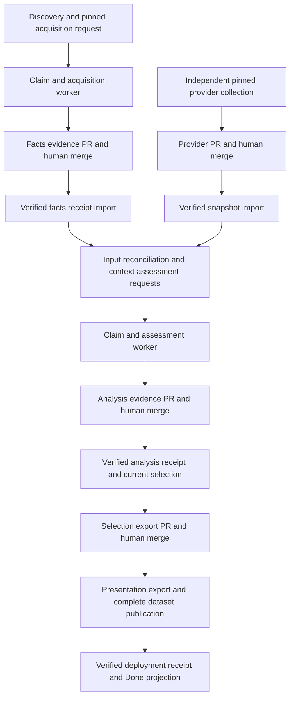

# Introduction

This plan connects the existing native components into one production pipeline.
Ledermayer approved autonomous implementation and scoped PR creation/merges on
2026-10-07. New live operations and autonomous promotion retain separate gates.
TASK-043 owns integrated delivery; TASK-044,
TASK-033, TASK-034, TASK-038 and TASK-028 retain their existing verification
boundaries. TASK-042 auto-merge and selective CI/binary release are excluded.
`STEP-*` and `CHECK-*` below are local execution identifiers, not new v2 tasks
or required-test IDs. All implementation steps remain incomplete until their
full exit checks pass. STEP-001 has a locally verified module-aggregate binding
repair; cold-loading, heartbeat and live failure diagnosis remain open.

Worker transport is staged behind `manual-worker-validation.yml`, which calls
the reusable `factory-worker.yml`. The existing `manual-worker.yml` and both
dispatchers remain unchanged until separately authorized bounded manual proof.
Otherwise changing the existing wrapper would implicitly promote the new jobs
into scheduled dispatch. This temporary validation entry point is removed or
consolidated only with reviewed transport promotion; STEP-002 is not complete.

Current evidence: worker run `37595175277` succeeded and prepared branch
`factory/v2-evidence-37595175277-1`, but its workflow did not open a PR or merge
data. Run `37607853401` failed in preparation before compute and produced no
artifacts; its root cause is not established by the run summary. F-019/F-020
record missing lifecycle projection and downstream wiring. The acquisition
proposal builder rejects assessment artifacts explicitly.

## 1. Requirements & Constraints

- **REQ-001**: Give autonomous dispatch a dedicated `factory-worker.yml`; retain a manual-only `manual-worker.yml` entry point and share the compute implementation instead of duplicating it.
- **REQ-002**: Persist lifecycle intents with successful claims, run binding, sealing, acceptance, recovery, selection and deployment reconciliation. Project committed truth through one shared reducer; never read board status to decide work.
- **REQ-003**: Display Queued after claim, Analyzing after worker binding and during trusted validation, Needs review for required review waits, Publishing for current analysis delivery/selection/deployment waits, and Done only for exact current deployed selections. Preserve Blocked, Failed and Retired semantics and mixed-context precedence.
- **REQ-004**: Keep acquisition separate from assessment. Acquire facts without provider snapshots; accept those facts first. Assessment reads exact accepted facts, definitions, policy and required provider snapshots. Missing inputs remain explicit and cannot become pass or empty-context Done.
- **REQ-005**: Open one idempotent evidence PR per durable proposal delivery. Merge through current human review controls, verify the actual accepted tree/merge receipt, then import into `factory-state`. Do not recompute sealed evidence to retry PR delivery.
- **REQ-006**: Accept independent provider snapshot proposals into `data/providers/<registry>/<namespace>/<provider>/versions/<version>/snapshots/<snapshot-id>/`; retain module evidence under existing `data/modules/` revision paths. Rebuild complete derived indexes/dataset without relocating immutable accepted records.
- **REQ-007**: Wake independent context assessments after both facts and required snapshot/policy acceptance, regardless of arrival order. Provider refresh reuses accepted facts with zero source checkout/parser execution and coalesces dependent work.
- **REQ-008**: Accept analysis evidence, select current context results, export selections through a separate reviewed PR, export safe presentation data, and publish the complete accepted dataset with exact deployment membership receipts.
- **SEC-001**: Preserve credential-free compute, trusted artifact validation, exact repository/workflow/event/code/run/attempt identity, monotonic fences, leases, expected-head non-force state writes, and reduced state/projection credentials.
- **SEC-002**: Do not introduce auto-merge, branch-rule bypass, permission/visibility changes, provider execution, private source collection, new provider allowlists or broader schedules. Preserve environment approvals and protected-main PR flow.
- **CON-001**: Validate manual counterparts with fixtures and separately authorized bounded live evidence before autonomous promotion. Retain the existing autonomous workload during initial implementation; do not start workers from discovery.
- **CON-002**: Keep trusted validation as a separate job, while mapping its display phase to Analyzing. Do not remove historical Validating records or change immutable contracts solely to simplify board columns. Do not delete the existing Project option in this plan.
- **PAT-001**: Reuse `queue.ReduceModuleStatus`, existing durable projection delivery, typed proposal application, evidence/selection receipts and indexed deployment verification. Update neighboring tests and existing registers rather than introduce a second queue or acceptance protocol.

Target dependency flow:

## 2. Implementation Steps

### Implementation Phase 1: Establish Worker And Projection Contracts

- **GOAL-001**: Dedicated worker execution and visible committed progress, without changing accepted data or enabling new unattended delivery. Steps run sequentially.

| Task | Description | Completed | Date |
|------|-------------|-----------|------|
| STEP-001 | Inspect exact failed-run preparation logs and durable attempt ownership read-only. In `cmd/factory/work.go` (`prepareWorkerInput`, `sealWorkerArtifact`) and `internal/queue/dispatch.go`, reproduce the classified failure with a fixture before repairing it. Verify lease/heartbeat and terminal recovery across the existing job bounds. Preserve unknown owners; do not rerun failed attempts or reset claims without recovery approval. | No | Not executed |
| STEP-002 | Add reusable `.github/workflows/factory-worker.yml` using `workflow_call` only. Keep `manual-worker.yml` as a `workflow_dispatch` wrapper; convert factory/manual dispatch handoffs to dependent reusable workflow calls carrying exact attempt/request/fence/dispatcher identities. Bind the top-level Actions run/attempt explicitly and reject mismatched claims. Update receipt producer allowlists in `manual-accept-evidence.yml`, recovery lookup and neighboring CLI workflow tests together; retain exact historical worker identities for pending artifacts. Keep existing concurrency and one-compute ownership guarantees. | No | Not executed |
| STEP-003 | In `internal/queue/dispatch.go`, `cmd/factory/work.go`, `cmd/factory/evidence_acceptance.go` and `cmd/factory/discovery_projection.go`, add a shared lifecycle-input adapter to `queue.ReduceModuleStatus`. Persist coalesced intents atomically with owned transitions. Fold active trusted-validation display into Analyzing without changing sealed evidence. Build fixture cases for claim, bind, seal, failure, protected retry, newer desired work and independent contexts. | No | Not executed |
| STEP-004 | Add manual projection-flush orchestration over existing durable delivery APIs, with reduced tokens, generation checks, pending-only scope, bounded budgets and independent checkpoints. Reuse existing Issue bindings and shared run-evidence comments. Board failure must leave retryable delivery, not undo worker progress. After approved manual verification, propose event-driven factory flush separately; no new periodic schedule here. | No | Not executed |

Exit: exact worker transport/provenance fixtures pass; committed claims display
Queued, bound workers display Analyzing, partial projection is recoverable, and
no historical callback gains authority. Live promotion requires separate approval.

### Implementation Phase 2: Deliver And Accept Acquisition Evidence

- **GOAL-002**: A sealed acquisition becomes a reviewable PR and verified facts receipt without another source scan. Depends on Phase 1.

| Task | Description | Completed | Date |
|------|-------------|-----------|------|
| STEP-005 | Extract review-branch preparation from the compute workflow into a recoverable delivery operation. Reuse `cmd/factory/evidence_proposal.go` and `internal/publish/evidence_builder.go`; verify the sealed completion before building against the current accepted base. Persist delivery identity, branch/PR binding and retry state in the existing module outbox ownership model. Rebuild proposals/indexes on base movement from the same immutable artifact, never blindly rebase JSON or force-push. | No | Not executed |
| STEP-006 | Open/find an exact-proposal PR using GitHub API integration with narrowly scoped credentials and a stable hidden delivery marker. Verify existing PR repository/base/head/payload before reuse. Keep human merge, no auto-merge enrollment. Handle push-success/lost-ack and PR-success/lost-ack without duplicates. For token-generated events, verify CI is actually triggered; use the approved App identity where default-token event suppression would strand checks. | No | Not executed |
| STEP-007 | Extend `manual-accept-evidence.yml` and `cmd/factory/evidence_acceptance.go` to consume an exact accepted commit and verify typed candidate reconstruction, artifact digest, producing run/jobs and sealed attempt. Preserve facts-only acceptance as distinct from analysis selection. Test an overall failed worker whose compute/seal succeeded. Add automatic post-merge reconciliation only after approved manual proof; ignore unrelated merges and make duplicate imports no-ops. | No | Not executed |

Exit: fixture PR creation/recovery and exact merge import pass. One separately
authorized acquisition PR is human-merged and its receipt imported; artifact
expiry or missing artifacts produce explicit recovery state, not fabricated data.

### Implementation Phase 3: Provider Inputs And Assessment Delivery

- **GOAL-003**: Accepted facts and accepted provider inputs wake and deliver context analyses. Depends on Phase 2 and the applicable Phase 4 recovery gates in the parent delivery plan.

| Task | Description | Completed | Date |
|------|-------------|-----------|------|
| STEP-008 | Reuse `manual-provider-collect.yml`, `manual-provider-export.yml`, `cmd/factory/provider_collection.go`, approved `config/providers.yaml` and typed provider proposals. Add idempotent reviewed PR delivery plus exact merged snapshot receipt import and sanitized collection health. Preserve last-good data on collection failure. Select explicit reviewed version/commit targets; missing/unavailable major tracks stay unresolved. No collection schedule or guessed latest target. | No | Not executed |
| STEP-009 | Wire accepted facts and snapshot/policy imports through `internal/queue/assessment_wakeup.go`, `internal/queue/provider_refresh.go` and existing `ImportAssessmentInputs` contracts. Persist required track contexts and exact input vectors. Test facts-first/snapshot-first arrival, zero dependents, duplicate imports, relevant provider changes and incomplete-extraction fallback. Advance only affected desired assessments; preserve independent active generations. | No | Not executed |
| STEP-010 | Extend `BuildModuleEvidenceProposal` in `internal/publish/evidence_builder.go` and `cmd/factory/evidence_proposal.go` to support sealed assessment artifacts as well as acquisition. Stage immutable analyses/dimensions/definitions/provenance through existing typed contracts and rebuild complete indexes. Deliver and import through Phase 2 APIs. `cmd/factory/work.go` must prepare assessments entirely from accepted pinned inputs, with zero source fetch or parser invocation. | No | Not executed |

Exit: one acquisition's accepted facts feed independent pinned context analyses;
analysis PR merge/import is verified; provider-only refresh changes only dependent
results and cannot claim missing capabilities or unsupported compatibility.

### Implementation Phase 4: Selection And Publication

- **GOAL-004**: Current accepted analysis reaches the portal and only verified deployment yields Done. Depends on Phase 3.

| Task | Description | Completed | Date |
|------|-------------|-----------|------|
| STEP-011 | Wire `SelectAccepted`, `ImportSelectionReceipt` and existing selection export outboxes into CLI/manual delivery. Create a separate reviewed `selection_export` PR; verify current context pins, desired fingerprints and monotonic receipts. Import its exact merge without selecting again. Preserve late evidence as history and reject stale selection promotion. | No | Not executed |
| STEP-012 | Wire existing typed presentation export and indexed site rendering through a manual publication counterpart. Export allowlisted reduced lifecycle/health on meaningful changes, not heartbeat/receipt-only loops. Deploy the exact complete accepted data commit after current approval checks; persist generation and membership receipts and reconcile them through existing indexed verification. Preserve current Pages approvals. | No | Not executed |
| STEP-013 | Connect deployment reconciliation to Phase 1 projection. Run the parent TASK-028 one-module then ten-module gate only with separate approval, recording exact PRs, commits, facts/analysis/selection IDs, failures, receipt memberships and board outcomes. A sibling failure must not block another module's evidence delivery. Propose factory counterparts only for manually proven operations; keep TASK-042 and broad schedules separate. | No | Not executed |

Exit: complete-dataset deployment has exact current selection membership, Done
cannot derive from worker success alone, and recovery retains accepted history.

## 3. Alternatives

- **ALT-001**: Rename the dispatch-only worker to factory-worker while retaining `workflow_dispatch`. Rejected because it violates the approved workflow-family contract and does not remove machine/manual transport coupling.
- **ALT-002**: Combine acquisition, provider collection and assessment in one worker. Rejected because provider snapshots are independently accepted shared inputs and provider-only refresh must not rescan module sources.
- **ALT-003**: Merge artifacts directly to main or implement TASK-042 first. Excluded: current review controls remain; this plan fixes delivery before changing automatic merge authorization.
- **ALT-004**: Mutate Issue status directly in each workflow. Rejected because durable intents, shared reduction and retryable projection must govern board truth.

## 4. Dependencies

- **DEP-001**: Existing TASK-022 through TASK-027 contracts and typed data schemas; fixture completion does not establish production integration.
- **DEP-002**: Exact public provider pins and accepted snapshots under TASK-029/TASK-030/TASK-033/TASK-041. Block missing required inputs rather than fabricate snapshots or waive recovery gates.
- **DEP-003**: Approved App grants, effective main/state rules and publisher/Pages environments, rechecked before each corresponding remote-write activation. No permission changes are approved here.
- **DEP-004**: Implementation approval for this plan and separate bounded manual/live promotion approval. TASK-042, CI router and binary releases are independent follow-ups.

## 5. Files

- **FILE-001**: `.github/workflows/factory-worker.yml` (new), `manual-worker.yml`, `factory-dispatch.yml`, `manual-dispatch.yml`, `manual-accept-evidence.yml`, `manual-recovery.yml`: transport, provenance and manual receipt integration.
- **FILE-002**: `cmd/factory/work.go`, `evidence_proposal.go`, `evidence_acceptance.go`, `discovery_projection.go`, `provider_collection.go`, `presentation.go`, `native.go`: owning CLI adapters; add new command files only where no existing owner fits.
- **FILE-003**: `internal/queue/dispatch.go`, `status.go`, `assessment_wakeup.go`, `provider_refresh.go`; existing `internal/state/`, `internal/github/` and `internal/publish/`: owned transitions, intents, proposal/receipt delivery and indexed publication.
- **FILE-004**: Existing neighboring CLI/queue/publish/GitHub tests; new transport/projection/publication manual workflow files only where an independent entry point is required. Factory counterparts follow reviewed manual verification.
- **FILE-005**: `docs/TODOS.md`, `docs/FINDINGS.md`, `docs/issue-lifecycle.md`, `docs/factory-operations.md` and relevant parent v2 task records: maintain truthful wiring diagrams and verification evidence after each implemented phase.

## 6. Testing

- **CHECK-001**: Parent TEST-004/017: forged request/fence/run/attempt/caller, duplicate reusable calls, historical recovery lookup, lost dispatch acknowledgement and unknown/expired ownership fail safely; terminal failure does not strand unclassified leases.
- **CHECK-002**: Parent TEST-009/010/012/013: atomic lifecycle intents, mixed contexts, validation-as-Analyzing, stale generation writes, partial board success, human-note preservation and budget retry retain truthful state.
- **CHECK-003**: Parent TEST-001/006/007/008: all accepted data preserved; acquisition and assessment proposal reconstruction matches the exact merged tree; PR/delivery/import retries are idempotent; current-base changes regenerate only derived proposal output; expired artifacts are explicit.
- **CHECK-004**: Parent TEST-002/014/015/020: accepted-input arrival order, exact snapshots, zero dependents, incomplete coverage and independent tracks; provider refresh has zero source checkout/parser calls and preserves unrelated dimensions.
- **CHECK-005**: Parent TEST-008/009/018/021: current selection and exact complete deployment receipts, retirement/new desired inputs, reversed callbacks, approval waits and receipt-only loop prevention; Done requires all required contexts.
- **CHECK-006**: At each substantive edit run the cheapest owning fixture first. Before phase review run changed-file formatting, `go test ./... -count=1`, `go vet ./...`, `go run ./cmd/factory --list-dimensions`, workflow-contract YAML/shell checks and applicable schema checks. Test external/GitHub behavior with fixtures, never credentials.
- **CHECK-007**: Validate this plan's front matter, required sections, unique local identifiers, linked workspace files and unchanged authoritative task completion states. Live verification is separate from local checks and must cite exact outcomes in existing registers.

## 7. Risks & Assumptions

- **RISK-001**: Reusable worker runs belong to caller workflow identities; stale single-filename receipt/recovery checks could reject valid new evidence or trust an unrelated caller. Update and fixture-test every handoff boundary before switching dispatch.
- **RISK-002**: Existing sealed attempts and branches may target old main bases or expire. Recover exact identities read-only first; rebuild delivery from verified evidence without claiming existing branches are merge-ready.
- **RISK-003**: Shared dataset/index paths cause concurrent PR conflicts. Serialize proposal delivery where needed, preserve sealed work, and reconstruct candidates against the current base rather than expand compute serialization.
- **RISK-004**: New lifecycle intents/comments add API cost. Coalesce transitions, checkpoint independently, retain reserve/retry policy and do not widen quotas or schedules.
- **ASSUMPTION-001**: Current accepted-data layout stays unchanged; module-owned operational layout and all retained writers remain compatible. Source-proven gaps require fresh verification against the actual implementation base.
- **ASSUMPTION-002**: The displayed pipeline may return to Queued/Analyzing after facts acceptance when assessment becomes runnable; board status represents current required work, not a strictly one-way progress bar.

## 8. Related Specifications / Further Reading

- [Factory tasks and validation](../docs/TODOS.md)
- [Decisions and approval boundaries](../docs/decisions.md)
- [Current source-proven wiring gap](../docs/FINDINGS.md#f-019-board-progress-and-pages-publication-are-not-wired)
- [Factory operations](../docs/factory-operations.md)
- [Native Issue lifecycle](../docs/issue-lifecycle.md)
- [Workflow operations contract](../.github/instructions/github-operations.instructions.md)
- [Authoritative operating model](../../plan/design-avm-intelligence-operating-model-2.md)
- [Authoritative delivery plan](../../plan/refactor-avm-intelligence-delivery-2.md)